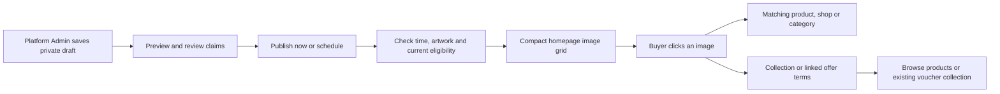

# Managing Marketplace Advertisements

Platform Admin manages advertisements from **Advertisements** in its existing
console. An advertisement combines reviewed artwork, a selected destination and
a display period. A banner never activates a discount, changes a product price
or places an order.

## Create and publish

1. Choose **New advertisement**, or import supplied artwork as a private draft.
2. Enter the title, accessible image description and optional collection or
   terms summary. Upload JPEG, PNG or WebP artwork, at most **5 MiB
   (5,242,880 bytes)**. Use **1880 × 880** where possible; the minimum is
   **940 × 440**, with the same **47:22** shape within 1%. Each edge must be
   at most 4096 pixels and the image at most 16 megapixels. Invalid files and
   incorrect shapes are rejected rather than silently cropped.
3. Select a product, eligible shop, active category, collection of 1–24 eligible
   products, or offer destination. A saving or offer purpose requires a real
   published voucher. Its products and dates must support the advertisement.
4. Choose one of three main-slide positions or two side-image positions. Enter
   start and end times in **Asia/Manila**. Save the draft; saving does not make
   it public.
5. Preview the saved revision at desktop and mobile widths. Review its actual
   destination, dates and offer terms, including any spending minimum, cap and
   shipping charge that may remain. The optimized image targets 350 KiB or less;
   the editor flags larger renditions for review. Text readability matters.
6. Confirm that every claim in the saved artwork is accurate. Choose
   **Schedule** for a future start, or **Publish now**, which uses server time
   and the saved end time. The image processor cannot verify marketing text.

Title and image description limits are 1–80 and 1–180 characters respectively;
the optional summary is at most 600 characters. Only decoded JPEG, PNG and WebP
content is accepted. Original uploads remain private, and optimized WebP images
use generated paths. PDF, SVG, GIF, video and unreadable files are rejected.

Supplied sale artwork is a candidate, not an active sale. Importing it neither
publishes it nor creates vouchers. Complete and verify its claims before use, or
replace it with accurate artwork. Ordinary seller shop branding keeps its
existing owner controls and approval rules.

## Buyer journey



Linked offers open their terms page even when a specific product or shop is
selected. The page shows the actual issuer, saving, minimum spend, cap, period
and use limit. Opening an advertisement does not save or apply a voucher, add
anything to the Shopping Bag, reserve stock or bypass approval. Guests and
pending buyers may browse; owned actions and checkout retain their existing
sign-in and approval rules.

The homepage retains the larger left carousel and two smaller supporting images,
with arrows inside the main image. Empty positions disappear. A single main
image has no carousel controls, and partial content remains compact. With no
eligible live advertisements, buyers see normal product browsing.

## Change, pause or end

- Editing creates a retained draft revision. The live revision continues until
  the replacement is published. Publishing an overlapping replacement ends the
  earlier overlapping placement at the replacement start; it does not restart
  that older placement afterward.
- Two advertisements cannot reserve the same position during overlapping
  periods. Adjacent periods may share an endpoint. One advertisement cannot
  occupy two positions during the same period.
- **Pause** hides the placement but keeps its reservation. **Resume** rechecks
  eligibility. **End placement** releases its remaining reservation. An
  unavailable destination also keeps its calendar reservation until ended.
- **Archive advertisement** stops its placements and prevents further editing.
  Its revisions, assets and decision history remain recorded.
- A stale editor keeps entered values, blocks publication and asks for a reload
  and fresh review. Retrying an identical recorded request cannot duplicate a
  decision. Failed storage or database writes preserve the working publication.

Every fresh read checks `starts_at <= now < ends_at`, pause/end state, current
catalogue eligibility, artwork and linked published voucher terms. Expiry does
not depend on a scheduled job. Withdrawn or sold-out targets, suspended shops,
changed offer revisions and exhausted offers can remove a placement earlier.
These responses use private, non-storing cache headers. Already-open pages need
a fresh request to reflect a later change; following an image always rechecks
its saved publication. Old ended links show an unavailable message and browsing
choices instead of redirecting to a new promotion.

Private previews require current Platform Admin access and are excluded from
indexing. Previously public optimized renditions can remain accessible through
their historical image URLs. Private originals and never-started, canceled
placement artwork are not served through the public artwork route.

## Installation and disabling display

After the user publishes and merges the branch, deploy using the existing
repository workflow:

```sh
./bagoo.sh deploy
./bagoo.sh verify
```

Deployment rebuilds PHP with WebP support, builds the frontend, runs the additive
migration and refreshes application caches. Keep database and private-file
backups together. The feature does not require a database reset or reseeding,
and it does not automatically publish supplied artwork. A missing advertisement
migration leaves normal marketplace browsing available and blocks management
with an installation message.

Set `ADVERTISEMENTS_ENABLED=false` in the deployment environment and refresh the
configuration cache to stop public display while retaining records:

```sh
./bagoo.sh artisan config:cache
```

Re-enable the setting and refresh the cache when ready. Current schedules and
eligibility still apply; old ended placements do not restart. Preserve the
tables and private files when disabling. The migration refuses to remove
retained advertisement identities on rollback.

Seller marketplace submissions and statistics are separate AD03 and AD04 work.
Paid placements, advertising balances and auctions are outside this feature.
Current implementation evidence and verification limits belong in
[the roadmap](CORE_FLOW_ROADMAP.md); the original scope is in
[the advertisement plan](advertisement-plan/README.md).
