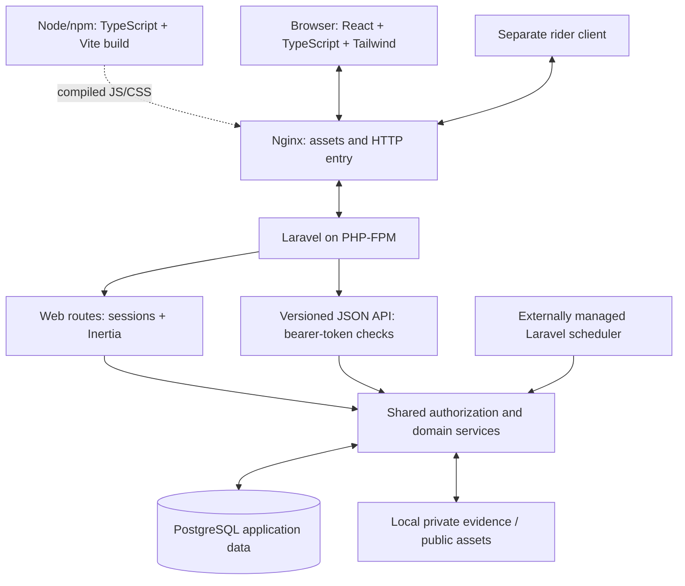

# BagooPH System Architecture

Verified against the web repository on October 16, 2026. This describes the
implemented structure and its boundaries; current release/test evidence belongs
in [CORE_FLOW_ROADMAP.md](CORE_FLOW_ROADMAP.md). Normative business and custody
rules remain in [SYSTEM_FLOW_AND_SPECIFICATIONS.md](SYSTEM_FLOW_AND_SPECIFICATIONS.md)
and [SORTING_CENTER_LOGISTICS_FLOW.md](SORTING_CENTER_LOGISTICS_FLOW.md).

Read [TECH_STACK.md](TECH_STACK.md) for exact dependency versions and source
references, or [TECH_STACK_PRESENTATION.md](TECH_STACK_PRESENTATION.md) for a
short explanation of what the tools do and why they fit BagooPH.

## Application shape

BagooPH is a **modular monolith**: one Laravel application, a shared relational
database and business services grouped by domain. Controllers coordinate HTTP
requests; services and models enforce account, commerce, logistics and money
rules. The web interface is React with TypeScript, connected through Inertia.
A versioned rider JSON API enters the same backend services.

This classification describes the existing source/deployment boundaries, not a
framework-enforced module system. Nginx, PHP-FPM and PostgreSQL are separate
infrastructure services defined in Compose. Separating those processes does not
make each business domain an independently deployed service.

The deployment target is an Azure VM. Private host/port/TLS/firewall settings
and operating background processes require deployment evidence; they are not
established by this diagram or a local build. The separate rider application's
SDK/packages/device behaviour are outside this web repository review.

## Web request and Inertia response

1. Nginx serves static assets or forwards a PHP request to `app:9000`.
2. Laravel selects a route from `routes/web.php` or `routes/auth.php` and runs
   its middleware. Authentication identifies the account; current eligibility
   and action-specific ownership checks determine permission.
3. A controller coordinates validated input, services, model relationships and
   the appropriate transaction. The browser cannot supply authoritative prices,
   role, stock, approval, custody or settlement state.
4. A page controller returns `Inertia::render` with a component name and allowed
   props. The first response uses `resources/views/app.blade.php`; later Inertia
   visits exchange page data and redirects through the existing Laravel server.
5. `resources/js/app.tsx` resolves the React page under `Pages`. Inertia's client
   adapter handles visits and form results. Focused JSON requests also exist for
   previews, quotes, messages and other ordinary same-origin actions.

For example, `ProfileController::edit` delegates a buyer's `/profile` read to
`BuyerProfileController`, which builds the owned `Buyer/Profile` page. A buyer's
read permission is separate from permission to place orders or mutate the
account. This prevents an interface entry point from defining its own approval
policy.

Inertia is an integration layer inside the application and a page-response
protocol. It is not an extra deployed API gateway. React owns rendering and
interactive state; Laravel owns routing, permitted page data and business rules.
The browser build has no configured Inertia server-side-rendering service.

Buyer catalogue navigation adds a bounded Inertia prefetch policy for reviewed
home/search/product GET reads. It retains page responses briefly in the current
client's memory, isolates account/context/version transitions and yields to
foreground work. Search can use same-component partial responses; lazy category
props avoid recomputing unused category totals for those updates. The middleware
preserves feedback and excludes unsupported or activity-changing speculative
reads. Page preparation never establishes current checkout or operational
authority, and private HTTP response headers remain intact. See the
[performance policy](performance-plan/POLICY.md),
[acceptance/configuration guide](performance-plan/ACCEPTANCE.md) and
[current evidence](CORE_FLOW_ROADMAP.md#october-16-2026-pf01-buyer-pagination-and-responsive-search).

## Versioned native API

`bootstrap/app.php` mounts `routes/api.php` under `/api`. The rider contract uses
`/api/v1`, for example:

| Existing endpoint | Purpose |
|---|---|
| `POST /api/v1/auth/tokens` | Create a permitted rider account token |
| `GET /api/v1/rider/home` | Read the owned current rider work overview |
| `PATCH /api/v1/rider/duty` | Request a validated duty change |
| `POST /api/v1/rider/pickup-jobs/{job}/claim` | Claim an eligible pickup job |
| `GET /api/v1/rider/commands/{key}` | Reconcile the retained result of an operational command |
| `GET /api/v1/rider/settings` | Read owned account settings |
| `DELETE /api/v1/auth/tokens/current` | Revoke the current permitted token |

These are REST-style HTTP JSON interfaces with both resource and action routes.
The complete web system also uses session-backed page responses and redirects;
calling every route strictly RESTful would hide those distinctions.

Sanctum provides personal-access-token storage. `EnsureRiderAccountToken` and
`RiderAccountService` implement current-account, token-ability and credential
checks; `PrivateRiderResponse` and `RiderApiResponse` shape the native response
boundary. The contract requires request identities for the relevant mutations;
`RiderCommandService` retains command fingerprints and results so retries can
recover an original outcome. Token access does not bypass current assignment,
company, ownership or parcel-state authority.

The same actor-owned services are used by web and native operations. The client
never connects directly to PostgreSQL or changes a parcel status by editing a
page. Refer to [account access](RIDER_ACCOUNT_API.md), [settings](api/RIDER_SETTINGS_API.md),
[operations](api/RIDER_OPERATIONS_API.md), [handover](api/RIDER_HANDOVER_API.md)
and [company joining](api/RIDER_COMPANY_API.md) for exact API contracts. The public
tracking JSON route is a separate masked, rate-limited read boundary.

## Backend layers and domain map

| Layer/domain | Existing source | Responsibility |
|---|---|---|
| HTTP entry | `bootstrap/app.php`, `routes`, `app/Http/Middleware` | Route selection, authentication, rate limits, private responses and current access checks |
| Controllers and requests | `app/Http/Controllers`, `app/Http/Requests` | Coordinate input, services and page/JSON/redirect results |
| Orders | `app/Services/Orders` | Quotes, checkout transactions/submission retries, lifecycle, tracking and owned workspaces |
| Logistics and courier | `app/Services/Logistics`, `app/Services/Courier` | Routing, placement, manifests, physical scans, counter collection, failed attempts and recovery |
| Governance | Account/review/restriction/correction services in `app/Services` | Independent recorded decisions and protected identity/account changes |
| Cash and settlement | `app/Services/Finance` | Collection, handovers, differences, reconciliation and evidenced seller payment |
| Internal virtual wallet | `app/Services/Wallet` | Admin-approved demo credits, balanced immutable journals, original exact payments, expiry, refunds and separate virtual seller proceeds |
| Campaigns | `app/Services/Vouchers`, `app/Services/Advertisements` | Saved terms, funding/limits, reviewed publication and bounded reporting |
| Notices | `app/Services/Notifications` | Durable recipient intent, owned presentation and retryable delivery |
| Persistence | `app/Models`, `database/migrations` | Relationships, casts, constraints, transactions and retained records |
| Presentation | `resources/js`, `resources/views` | Portal layouts, controls, allowed data and form feedback |

Use the current source for exact classes. These are logical responsibilities,
not independently deployed microservices or a claim that every controller is
free of legacy coordination logic.

## Access and tenant boundaries

The stored roles are `buyer`, `seller`, `courier`, `logistics` and `admin`.
Pickup/final-mile are courier assignment phases. Company administrators and
hub handlers have scoped logistics responsibilities. An account's role is fixed
at creation; another role requires its own account and review.

Every protected action must enforce the relevant current activity, approval,
owner, company, facility, assignment and state checks on the server. A hidden
button, login redirect, subdomain or valid token cannot replace authorization.

- Buyers see only their permitted personal records. Pending/rejected buyers
  may use the marketplace application context and permitted personal history;
  active approval is required for checkout. Known restrictions retain only the
  narrow personal/existing-order exceptions defined in the buyer contract.
- Each seller has one shop with reviewed category/pickup scope. Contact and
  branding edits remain separate from legal/scope corrections.
- Courier work depends on current company/hub placement, phase and assignment.
  Going on duty does not approve an account or grant company membership.
- Logistics actors operate within their own company and authorized facilities.
- Platform Admin reviews and oversees records; routine scans and receipt
  confirmation remain owned by the actual operational actor and buyer.

Root and configured subdomain portals use these same backend boundaries.
Original sign-in email, private evidence, review history and fixed-role rules
follow the account/domain contracts rather than UI convenience.

## Transactions, evidence and retry safety

Checkout commits stock, per-shop orders, parcels and the retained confirmation
result together. Other critical writers validate the current source state,
lock the relevant records consistently and retain required evidence with the
mutation. Unique constraints and request identities prevent duplicate work;
changed intent using an old identity is rejected.

Approval, custody, retry/return, cash and settlement histories retain their
original sources. Corrections append explicit related evidence rather than
rewriting history. Required private files are served through authorized access;
public avatars and product artwork use a separate public-storage boundary.

A normal parcel follows seller -> pickup rider -> origin Bayan Hub -> at least
one Mother Hub -> destination Bayan Hub -> delivery rider or authorized counter
-> buyer. Every custody handoff needs its own permitted scan/evidence. Supported
transport is contiguous land travel, with no direct Bayan-to-Bayan shortcut.

Commercial state, physical custody and cash are separate. Only the buyer moves
`DELIVERED` to `COMPLETED`. Buyer confirmation and platform COD reconciliation
can arrive in either order; seller payment waits for both and its own evidence.
The product split is 90% seller and 10% platform; shipping and promotional
funding remain separate. Recording payment is not an automatic bank transfer.

The selected [Bagoo Wallet](BAGOO_WALLET.md) adds internal virtual credits without
changing the parcel route or buyer-only completion. Its exact original prepayment,
refunds and virtual seller proceeds use a separate balanced journal. They do not
create a COD collection, cash remittance or bank-payment record.

These rules are implemented with application services and constraints. SQLite
checks and code review do not establish PostgreSQL contention or every deployed
failure mode. See [the validation contract](CORE_FLOW_VALIDATION_AND_EDGE_CASES.md)
and the dated roadmap for the actual evidence.

## Notifications and background work

`NotificationDeliveryService::record` stores recipient intent with the business
transaction and attempts delivery after commit. Failed delivery retains the
intent for `notifications:deliver-pending`; it does not erase a committed order,
scan or cash event. Owned previews and full notification pages read retained
records. This does not establish SMS, push or WebSocket delivery.

`routes/console.php` registers:

- Pickup holding/expiry processing every minute.
- Pending notification delivery every minute.
- Rider-company offer expiry every minute.
- Advertisement raw-event cleanup daily.

The example environment selects database sessions, cache and queues. Compose
starts only `app`, `web` and `db`; a scheduler/queue-worker process needs separate
operator configuration. There is no Redis service or configured realtime socket
server in this Compose arrangement. An external service template in framework
configuration is not evidence that the service is active.

## Build, deployment and external integrations

Vite builds assets after TypeScript checking; Nginx serves the compiled output
and PHP-FPM executes Laravel. Node is part of development/build tooling in the
PHP image. `bagoo.sh deploy` installs locked dependencies, builds assets, starts
services, migrates and rebuilds caches. `verify` checks the asset manifest and
pending migrations. Neither command proves every user journey or scheduler.

PostgreSQL data uses a named volume; the configured host database publication is
loopback-only and application traffic uses the internal Docker service. The
tracked Nginx configuration listens on HTTP; actual external HTTPS termination,
proxy trust, Azure ingress, backups and server operation require a deployment
review. Never put private server names, addresses or secrets into documentation.

Existing external boundaries include SMTP email, configured provider sign-in,
public address lookups with local fallback, map tiles, hosted fonts and optional
server-side text assistance. Their source configuration does not prove live
availability. Core pricing, approval, custody and settlement remain server
business rules and are not decided by those optional integrations.

## Verification boundary

Ordinary backend tests use SQLite `:memory:` and real Laravel HTTP/services with
controlled fixtures. Frontend harness checks are not a browser. Production
builds establish compilation, and formatting/link checks establish narrower
properties. Real device use, PostgreSQL-specific execution and live Azure
behaviour need their own evidence.

Use [TEST_INFRA.md](../TEST_INFRA.md) for the current test layout, safe commands
and limits, [SCHEMA.md](SCHEMA.md) for the verified data map, and
[WEB_AUTH_DEPLOYMENT.md](WEB_AUTH_DEPLOYMENT.md) for release operations.
