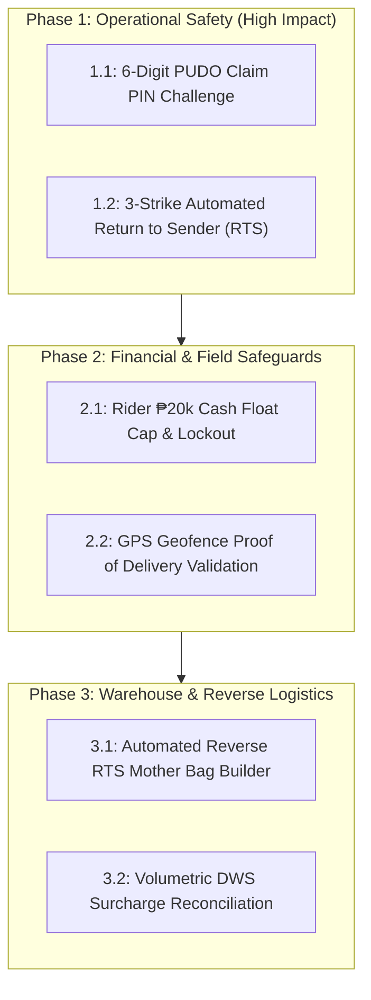

# Bagoo Enterprise Logistics Architecture & Execution Plan

> **Classification**: Authoritative Engineering Architecture & Implementation Blueprint  
> **Target Scope**: End-to-End Parcel Custody, Hub-and-Spoke Topology, Reverse Logistics (RTS), COD Escrow Financials, PUDO Operations, and Phased Implementation Plan  
> **Status**: Approved Blueprint for Execution  
> **Last Updated**: November 2026

---

## 1. Executive Summary: The Real-World Logistics Philosophy

Standard ride-hailing models (Grab, Lalamove) utilize point-to-point dispatch: 1 driver delivers 1 parcel directly from pickup to drop-off. While suitable for instant intra-city errands, point-to-point delivery scales linearly ($O(N)$ vehicles for $N$ deliveries) and is economically impossible for inter-provincial or nationwide e-commerce.

Bagoo’s logistics engine mirrors **real-world Southeast Asian logistics conglomerates (J&T Express, Shopee SPX Express, Flash Express)**. It organizes geography into an optimized **Hub-and-Spoke Network** designed around the physical realities of the Philippine archipelago:
1. **Bulk Linehaul Freight Consolidation**: Thousands of small packages are aggregated into high-capacity linehaul vehicles (wing-vans, container trucks, RORO ferries), lowering per-parcel transit costs by up to 85%.
2. **Mother Bag & Manifest Custody Contracts**: Individual pouches are consolidated into numbered, tamper-sealed nylon sacks, eliminating warehouse dock bottlenecks.
3. **Fail-Safe Reverse Logistics (RTS)**: Built-in handling for high cash-on-delivery (COD) failure rates (15%–30%) via a strict 3-attempt lifecycle.
4. **Counter Pickup (PUDO)**: Addressing unmapped sitios, rural barangays, and gated communities with 0% delivery attempt failures.

---

## 2. The Physical Network Topology

```
                       [ SELLER STORE / WAREHOUSE ]
                                    │
                                    ▼ (First-Mile Rider Pickup / Seller Drop-off)
                       [ ORIGIN BAYAN / CHILD HUB ]
                                    │
               ┌────────────────────┴────────────────────┐
      Same-Bayan Hub?                                    Different Bayan?
               │                                                 │
        YES (Local Bypass)                                       ▼ (Feeder Truck — Mother Bags)
               │                                 [ REGIONAL MOTHER HUB (Sorting DC) ]
               │                                                 │
               │                                                 ▼ (Linehaul Heavy Freight)
               │                                 [ DESTINATION MOTHER HUB (Sorting DC) ]
               │                                                 │
               │                                                 ▼ (Feeder Truck — Mother Bags)
               │                                 [ DESTINATION BAYAN / CHILD HUB ]
               │                                                 │
               └────────────────────┬────────────────────────────┘
                                    │
                     ┌──────────────┴──────────────┐
                     ▼                             ▼
       [ LAST-MILE DELIVERY RIDER ]      [ COUNTER PICKUP (PUDO) ]
                     │                             │
                     ▼                             ▼
          [ BUYER DOORSTEP ]             [ BUYER SELF-COLLECTION ]
```

### 2.1 The Two Facility Types
- **Regional Mother Hub (Distribution Center / Gateway)**:
  - 5,000–30,000 sqm automated sorting warehouse situated adjacent to major expressways (e.g., SLEX, NLEX, Subic-Clark).
  - Handles high-volume cross-docking, linehaul truck dispatch, and regional automated sorting.
  - Does **not** service retail buyers or walk-in customers.
- **Local Child Hub (Bayan Hub / Delivery Station)**:
  - 100–300 sqm municipal station servicing 10–30 local barangays.
  - Dispatches first-mile pickup riders and last-mile delivery riders.
  - Manages walk-in customer self-collection (PUDO) and evening rider cash remittances.

### 2.2 The Same-Child Local Bypass
- When both merchant and buyer reside within the catchment area of the same Child Hub (e.g., both in Los Baños), the package **bypasses the Mother Hub entirely**.
- Intake immediately tags the item for the local delivery rack, slashing transit time from 48 hours to under 12 hours while eliminating intermediate freight handling.

---

## 3. Chain-of-Custody Technology

Loose parcels in transit create operational chaos: labels tear, small pouches slide under pallets, and unloading takes hours. Bagoo enforces atomic chain-of-custody tracking.

### 3.1 Mother Bags (Consolidation Sacks)
- 50 to 100 individual parcels destined for the same next facility are packed into a heavy nylon **Mother Bag**.
- The bag is closed with a single-use polypropylene pull-tight seal bearing a laser-etched serial number (`seal_number`).
- A barcoded **Master Bag Tag** is affixed.
- Receiving facilities scan **one Master Bag Tag** instead of 100 individual packages, completing inbound intake in milliseconds.

### 3.2 Electronic Transport Manifest (e-BOL)
- A transport manifest is a legal chain-of-custody transfer between the dispatch hub, the transport driver, and the receiving hub.
- It binds:
  ```json
  {
    "manifest_number": "MNF-20261108-0042",
    "driver_id": "DRV-8941",
    "vehicle_plate": "NDG-4819",
    "origin_hub_id": "HUB-LAG-01",
    "destination_hub_id": "HUB-MM-DC",
    "departure_at": "2026-11-08T02:00:00Z",
    "mother_bags": ["MB-77182", "MB-77183", "MB-77184"],
    "driver_signature_hash": "e3b0c44298fc1c149afbf4c8996fb92427ae41e4649b934ca495991b7852b855"
  }
  ```
- If a seal is cut or a package goes missing on the expressway, liability is isolated exclusively to that transport leg.

---

## 4. Reverse Logistics & The 3-Strike Rule (RTS)

In Philippine e-commerce, 15%–30% of cash-on-delivery shipments fail on the first attempt due to buyer absence, unlocated addresses, or missing contact info.

### 4.1 The 3-Attempt Lifecycle
```
[Out for Delivery] ──▶ [Failed Attempt 1] (Unreachable / Rescheduled)
                           │
                           ▼ (Next Business Day)
                       [Failed Attempt 2] (Rescheduled)
                           │
                           ▼ (Next Business Day)
                       [Failed Attempt 3 OR Explicit Customer Refusal]
                           │
                           ▼ (PARCEL FROZEN: NON-RETRYABLE)
                       [Status: return_to_sender]
                           │
                           ▼ (Packed into Reverse RTS Mother Bag)
                       [Destination Bayan Hub]
                           │ (Reverse Manifest)
                           ▼
                       [Sorting Center / Mother Hub]
                           │ (Reverse Manifest)
                           ▼
                       [Origin Bayan Hub]
                           │ (Courier Handover)
                           ▼
                       [Seller Restock & Physical Return Signature]
```

1. **Attempt Cap**: Maximum 3 delivery attempts. Each attempt requires a timestamped reason code, rider GPS coordinate, and proof photo.
2. **Explicit Refusal**: If the buyer explicitly cancels at the doorstep (*"Ayoko na niyan"*), the parcel transitions immediately to RTS on Attempt 1.
3. **Reversed Frozen Route**: The parcel returns along the exact reverse sequence of its forward journey.
4. **Seller Inspection**: The seller signs the digital proof of return only after inspecting the package seals for tampering.

---

## 5. Financial Architecture: COD, Escrow, and Safeguards

### 5.1 End-of-Day Cash on Delivery Reconciliation
```mermaid
sequenceDiagram
    autonumber
    actor Buyer
    actor Rider
    participant Hub as Bayan Hub Cashier
    participant Escrow as Bagoo Platform Escrow
    participant Seller as Seller Wallet

    Buyer->>Rider: Hands Cash at Doorstep (₱1,500)
    Rider->>Escrow: Submits Proof of Delivery (POD Photo + GPS + Cash Received)
    Note over Rider: Rider shift holds unremitted cash liability

    Rider->>Hub: End-of-Day Remittance (Hands cash to Cashier)
    Hub->>Hub: Cashier counts bills via optical UV counterfeit counter
    Hub->>Escrow: Confirms 100% Cash Match
    Note over Rider,Hub: Rider shift unlocked; liability cleared

    Escrow->>Rider: Credits Delivery Wage (₱45-₱75/drop)
    Escrow->>Escrow: Credits Logistics Company Freight Tariff & Platform Commission
    Escrow->>Seller: Releases Net Sales Amount to Available Wallet
```

### 5.2 Rider Cash Float Cap (₱20,000 Threshold)
- To eliminate driver abscondment risk, riders are capped at a maximum of **₱20,000 in unremitted COD cash**.
- Once the threshold is reached:
  - At **₱15,000**: Warning banner in rider app.
  - At **₱20,000**: App automatically suspends further delivery completion actions until a mid-shift cash drop is verified at a local Bayan Hub.

---

## 6. Counter Pickup (PUDO - Pick-Up & Drop-Off)

Counter Pickup solves delivery friction in unmapped rural sitios and gated subdivisions that restrict commercial riders.

1. **Destination Assignment**: At checkout, the buyer selects their nearest Bayan Hub.
2. **Intake Staging**: Upon arrival, the hub clerk scans the parcel into a specific physical pigeonhole cubby (`destination_bin`, e.g., `BIN-C04`).
3. **6-Digit Claim PIN**: The system generates a cryptographically random 6-digit PIN transmitted to the buyer's app/SMS.
4. **Counter Verification**: The buyer visits the counter, presents government ID, and provides the 6-digit PIN. The clerk inputs the PIN in [`CounterPickup.tsx`](file:///home/andy/Projects/bagoo/resources/js/Pages/Hub/CounterPickup.tsx) to authorize release.

---

## 7. Implementation Gap Analysis & Phased Execution Plan

### 7.1 Current System Status

| Functional Area | Current Status in Codebase | Remaining Gap to Implement |
| :--- | :--- | :--- |
| **Hub Network & Topology** | Parent-child hub database models, coverage checking, and bypass logic live. | None. Core topology is active. |
| **Manifests & Mother Bags** | [`Manifests.tsx`](file:///home/andy/Projects/bagoo/resources/js/Pages/Hub/Manifests.tsx) and [`MotherBags.tsx`](file:///home/andy/Projects/bagoo/resources/js/Pages/Hub/MotherBags.tsx) active with bag sealing and scanning. | Reverse Mother Bag staging queue for RTS parcels. |
| **PUDO Counter Pickup** | [`CounterPickup.tsx`](file:///home/andy/Projects/bagoo/resources/js/Pages/Hub/CounterPickup.tsx) UI exists with bin allocation. | 6-Digit Claim PIN generation and validation challenge modal. |
| **Delivery Attempts & RTS** | `DeliveryAttempt` records logged; manual status updates. | Automated 3-strike transition to `return_to_sender` status and frozen reverse pathing. |
| **Rider Cash Float Limits** | Basic COD settlement tracking live. | Real-time ₱20,000 float cap warning banner and lockout trigger in [`CourierUI.tsx`](file:///home/andy/Projects/bagoo/resources/js/Pages/Hub/CourierUI.tsx). |

---

### 7.2 Phased Engineering Roadmap



#### Step 1: PUDO 6-Digit Claim PIN Challenge
- Add `claim_pin` (hashed) and `claim_pin_expires_at` to orders designated for counter pickup.
- In `CounterPickup.tsx`, require the hub clerk to submit the 6-digit PIN before completing collection.
- Automated tests verifying PIN verification success and invalid PIN rejection.

#### Step 2: 3-Strike Automated Return to Sender (RTS)
- Add lifecycle observer: When the 3rd failed `DeliveryAttempt` is recorded, or reason is marked `customer_refused`, order immediately transitions to `return_to_sender`.
- Freeze forward route and generate return tracking number (`RTN-` prefix).

#### Step 3: Rider ₱20,000 COD Cash Float Shield
- Add real-time unremitted COD sum calculation in `CourierTrip` controller.
- Display warning banner at ₱15,000.
- Lock delivery completion buttons when unremitted COD reaches ₱20,000 until a hub cashier logs a partial remittance.

#### Step 4: Verification & Test Coverage
- Execute full test suite (`php artisan test tests/Feature/Logistics/`).
- Verify complete White Mode UI rendering via Puppeteer across Bayan Hub counter, Mother Hub scanning, and Rider Courier views.
