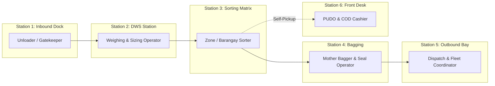
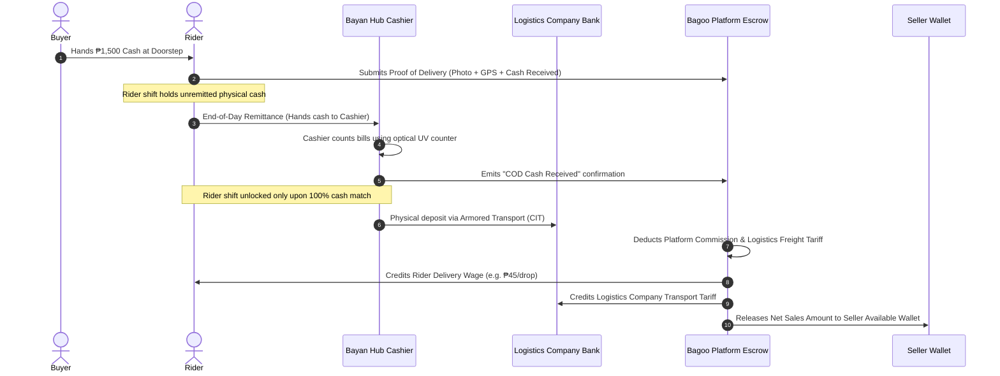

# Bagoo Enterprise Logistics Architecture & Thesis Defense Specification

> **Document Classification**: Authoritative Engineering & Defense Reference  
> **Target Scope**: End-to-End Parcel Flow, Reverse Logistics, Financial Reconciliation, Fleet & Vehicle Engineering, Warehouse Technology, Anti-Pilferage Security, and Thesis Defense Defense Matrix.

---

## SECTION 1. The Physical Pipeline & Network Topology

### 1.1 Hub-and-Spoke Architecture
Top logistics conglomerates (J&T Express, Shopee SPX Express, Flash Express, FedEx, DHL) do not dispatch peer-to-peer point-to-point courier trips across inter-provincial boundaries. Instead, they organize geography into a **Hierarchical Hub-and-Spoke Network**:

```
                       [ SELLER STORE / WAREHOUSE ]
                                    │
                                    ▼ (First-Mile Rider Pickup / Seller Drop-off)
                       [ ORIGIN BAYAN / CHILD HUB ]
                                    │
                                    ▼ (Feeder Transport — Manifest & Mother Bags)
                       [ REGIONAL MOTHER HUB (SORTING DC) ]
                                    │
                                    ▼ (Linehaul Heavy Freight — 10-Wheeler / RORO / Air)
                       [ DESTINATION MOTHER HUB (SORTING DC) ]
                                    │
                                    ▼ (Feeder Transport — Manifest & Mother Bags)
                       [ DESTINATION BAYAN / CHILD HUB ]
                                    │
                     ┌──────────────┴──────────────┐
                     ▼                             ▼
       [ LAST-MILE DELIVERY RIDER ]      [ COUNTER PICKUP (PUDO) ]
                     │                             │
                     ▼                             ▼
          [ BUYER DOORSTEP ]             [ BUYER SELF-COLLECTION ]
```

### 1.2 Core Logistics Terminology Defined

#### A. Mother Hub vs. Child (Bayan) Hub
- **Regional Mother Hub (Distribution Center / Gateway)**: A massive 5,000–30,000 sqm automated sorting warehouse located near strategic transit expressways (e.g., Laguna, Bulacan, Cebu, Davao). It does not service end buyers directly; it handles high-volume bulk cross-docking, linehaul truck dispatch, and regional sorting.
- **Local Child Hub (Bayan Hub / Delivery Station)**: A 100–300 sqm municipal facility servicing 10–30 local barangays. It handles first-mile rider dispatch, morning sort for neighborhood delivery routes, walk-in buyer self-collection (PUDO), and evening rider COD cash remittance.

#### B. Same-Child Local Bypass (Efficiency Optimization)
- If both merchant and buyer reside within the coverage zone of the same Child Hub (e.g., both in Los Baños), the parcel **bypasses the regional Mother Hub entirely**.
- It is received at Origin Intake, assigned immediately to the local delivery zone rack, and dispatched the next morning. This cuts transit time from 48 hours to under 12 hours and eliminates inter-hub transport costs.

#### C. Mother Bags (Consolidation Sacks / Totes)
- **The Physical Problem**: Loading 10,000 loose small parcels into a 40-foot wing-van creates logistical chaos. Unloading takes 5+ hours, small pouches slip under pallets, and barcodes tear.
- **The Solution**: 50–100 parcels destined for the same receiving hub are packed into a heavy-duty nylon/canvas **Mother Bag**.
- The bag is closed with a numbered, tamper-evident polypropylene pull-tight seal (**Seal Number**) and labeled with a barcoded **Master Bag Tag**.
- When the truck arrives at the sorting center, workers scan **one Master Bag Tag** instead of 100 individual items, completing intake in 200 milliseconds.

#### D. Manifests (Electronic Bill of Lading / e-BOL)
- A transport manifest is a legal chain-of-custody contract between the sending facility, the driver, and the receiving facility.
- It binds: `Vehicle Plate`, `Driver Identity`, `Departure Timestamp`, `Destination Facility`, and the `Full Inventory of Sealed Mother Bags and Bulk Items`.
- Custody is legally transferred only when the driver signs digitally. If a seal is cut or a bag goes missing on the expressway, the manifest isolates liability to the specific transit leg.

#### E. Linehaul (Trunkline Freight)
- **First-Mile**: Motorbikes and L300 vans collecting shipments from merchants.
- **Last-Mile**: 2-wheelers or 3-wheelers delivering parcels to residential doorsteps.
- **Linehaul**: The scheduled highway trunkline freight operating between Mother Hubs via 6-wheeler forward trucks, 10-wheeler wing-vans, 40-foot container tractors, inter-island RORO shipping, or cargo aircraft. Linehaul operates on fixed timetable slots (e.g., leaves at 02:00 AM sharp whether full or half-empty) to honor delivery SLAs.

#### F. Counter Pickups (PUDO - Pick-Up & Drop-Off)
- In the Philippines, delivery failure rates are high due to gated community restrictions, unpaved sitios lacking house numbers, and buyers working outside the home during daylight hours.
- **Counter Pickup** allows the buyer to designate the local Bayan Hub as the destination.
- The parcel is assigned to a physical staging cubby (`destination_bin`, e.g., `BIN-C04`).
- The buyer receives an automated SMS/app notification with a 6-digit claim PIN. They walk into the hub at their convenience, present their ID and PIN, pay COD (if unpaid), and retrieve their package with zero delivery attempt failures.

---

## SECTION 2. Specialized Hub Workforce: The 6 Station Roles

A real logistics facility does not use generic handlers; work is divided into 6 distinct, specialized stations:



1. **Inbound Gatekeeper / Unloader**: Cuts vehicle door bolt seals, cross-checks physical seals against the digital manifest, unloads trucks, and scans Mother Bag tags.
2. **DWS Operator (Dimension, Weight, Scan)**: Passes parcels through dynamic optical scales to verify that physical weight and volumetric dimensions match merchant declarations.
3. **Pigeonhole / Zone Sorter**: Takes items from conveyors and places them into designated zone cubbies corresponding to specific delivery barangays or child hubs.
4. **Bagger / Consolidation Operator**: Clears full pigeonhole racks into Mother Bags, generates the barcoded Master Bag Tag, pulls the plastic seal tight, and registers the seal serial number.
5. **Outbound Staging Coordinator**: Verifies vehicle load capacity, builds the electronic transport manifest, scans sealed bags into the cargo bay, and obtains the driver's digital signature.
6. **Counter Clerk & Cashier**: Manages the walk-in customer reception, validates claim PINs, receives end-of-day rider cash remittances, and counts paper currency on counterfeit-detecting counting machines.

---

## SECTION 3. Reverse Logistics: Failed Deliveries & Buyer Returns

In Southeast Asian e-commerce, **15% to 30% of all COD deliveries fail**. Without dedicated reverse logistics, inventory vanishes and sellers face stockouts.

### 3.1 Return to Sender (RTS) — Pre-Delivery Failure Lifecycle

```
[Out for Delivery] ──▶ [Failed Attempt 1] (Unreachable / Unlocated)
                           │
                           ▼ (Next Day)
                       [Failed Attempt 2] (Rescheduled)
                           │
                           ▼ (Next Day)
                       [Failed Attempt 3 OR Explicit Customer Refusal]
                           │
                           ▼ (PARCEL FROZEN: NON-RETRYABLE)
                       [Status: return_to_sender]
                           │
                           ▼ (Sealed into Reverse RTS Mother Bag)
                       [Destination Bayan Hub]
                           │ (Reverse Manifest)
                           ▼
                       [Mother Hub Sorting Center]
                           │ (Reverse Manifest)
                           ▼
                       [Origin Bayan Hub]
                           │ (Courier Handover)
                           ▼
                       [Seller Restock & Digital Proof of Return]
```

- **Attempt Rules**: Exactly 3 delivery attempts are permitted. If the buyer explicitly refuses (*"Cancel ko na yan"* or *"Wala akong inorder niyan"*), it transitions immediately to RTS on Attempt 1.
- **Route Freezing**: The parcel travels backwards along the **exact reversed frozen route** of its forward journey.
- **Restock Receipt**: The seller must physically inspect the package for tampering before signing the digital return receipt.

### 3.2 Buyer Returns — Post-Delivery Handover
- Within the **7-Day Guarantee Window**, buyers can submit a dispute for items received damaged, defective, or not as described.
- **Dedicated Return Barcode**: The system generates a distinct return tracking number (prefix `RTN-`) to prevent sorting algorithms from confusing forward shipments with returns.
- **Escrow Freeze**: Buyer payment remains locked in platform escrow until the returned parcel reaches the seller and passes physical inspection.

---

## SECTION 4. Financial Architecture: COD, Escrow, and Tariffs

### 4.1 End-to-End Cash on Delivery (COD) Reconciliation Cycle



### 4.2 Cash Safety, Shortages, and Discrepancies
- **Rider Cash Float Limits**: Riders are capped at a maximum cash holding (e.g., ₱20,000). Once reached, the system prevents further COD drop-offs until a mid-day cash drop is performed at a nearby Bayan Hub.
- **Rider Shortages**: If a driver's collection manifest indicates ₱18,500 but they remit only ₱18,000, their shift is held open, an automated deduction is logged against their security bond, and a Discrepancy Case is initiated.
- **Volumetric Tariff Adjustment**: If a seller declared a 300g weight but the DWS station measured 3,200g volumetric weight, the system automatically adjusts the shipping tariff and charges the seller's account balance.
- **Tax Withholding (BIR Form 2307)**: In the Philippines, platforms withhold 1%–2% Creditable Withholding Tax on merchant payouts and issue quarterly BIR 2307 certificates to logistics operators.

---

## SECTION 5. Advanced Logistics Engineering: What Thesis Panels Grill You On

To make an e-commerce logistics platform truly bulletproof in an academic or industrial thesis defense, the following 4 engineering pillars must be addressed:

### 5.1 Technology & Hardware Integration
1. **Barcode Symbologies**:
   - **Code 128 / GS1-128**: High-density 1D linear barcode used for long-distance laser gun scanning on high-speed conveyor lines.
   - **DataMatrix (2D)**: Compact 2D matrix used on small parcel pouches where space is tight; readable even with 30% label damage.
   - **QR Code (Model 2, ECC Level M)**: Used on buyer claim slips and mobile screens for optical camera readers.
2. **Dedicated Rugged Handheld Scanners (PDAs)**:
   - Consumer smartphone cameras are inadequate for warehouse floors (slow autofocus, poor low-light capability, battery drain).
   - Industrial Android PDAs (Zebra TC26, Honeywell ScanPal, Urovo) utilize dedicated hardware scan engines that decode barcodes in **under 50 milliseconds** at a rate of 40 scans per minute.
3. **Offline-First Synchronization (Edge Resilience)**:
   - In rural Philippine municipalities where cellular connectivity is intermittent, hubs run an **Edge Offline Buffer**.
   - Scans are queued in local IndexedDB / SQLite with cryptographic sequence timestamps and synchronised via background workers to the central server when connection restores.
4. **Dynamic Weighing & Sizing (DWS Systems)**:
   - High-throughput conveyor belts equipped with infrared light curtains and load-cell weight sensors calculate length × width × height in 0.5 seconds while parcels move at 2 meters per second.

### 5.2 Fleet, Routing & Vehicle Engineering
1. **Volumetric Weight vs. Actual Weight (Cubing Out vs. Weighing Out)**:
   - Standard freight formula:
     $$\text{Volumetric Weight (kg)} = \frac{\text{Length (cm)} \times \text{Width (cm)} \times \text{Height (cm)}}{3,500 \text{ (Domestic Express standard)}}$$
   - **Weighing Out**: Heavy dense cargo (metal tools, liquids) hits the truck’s axle weight limit while the cargo space is still half empty.
   - **Cubing Out**: Light bulky cargo (pillows, clothing) fills 100% of the truck’s physical volume while utilizing only 20% of its payload weight limit.
   - **Dispatch Optimizer**: Real logistics engines calculate cubic meter ($m^3$) packing algorithms (3D Bin Packing Problem) to balance weight and volume per vehicle.
2. **Vehicle Routing Problem (VRP) & Traveling Salesperson Problem (TSP)**:
   - Last-mile dispatch clusters parcels by geographic barangay centroids using Voronoi diagrams or K-Means clustering, minimizing turnarounds, fuel consumption, and left-hand turns.
3. **Roadside Breakdown Contingency**:
   - When a 10-wheeler breaks down on an expressway, the system executes an **Emergency Split-Manifest Protocol**: A rescue vehicle arrives, the physical seals are transferred under supervisor audit, and the digital manifest rebinds custody to the rescue vehicle's plate.

### 5.3 Anti-Pilferage, Security & Fraud Prevention
1. **Internal Warehouse Theft Deterrence**:
   - **Barcode-CCTV Time Correlation**: Every barcode scan records an exact millisecond timestamp. If a buyer receives an empty box, security scrubs surveillance footage directly at the exact second the parcel passed the packing station.
   - **Weight Delta Anomaly Detection**: A package weighed at Origin Intake (e.g., 1,450g) must match its weight at the Destination Hub (±15g tolerance). If a parcel arrives weighing 920g, an automated **Internal Pilferage Alarm** triggers before dispatch.
2. **Rider Fraud & Geofence Spoofing Prevention**:
   - Delivery proof requires **3-way cryptographic validation**:
     1. Exact GPS coordinates within a 50-meter radius of the delivery address.
     2. Cellular Tower ID / Wi-Fi BSSID triangulation (defeats Android "Fake GPS" mock location apps).
     3. High-resolution Proof of Delivery (POD) photo with embedded EXIF metadata.
3. **Tamper-Evident Security Seals**:
   - High-security numbered seals on Mother Bags and truck containers feature tamper-indicating frangible plastic or void-tape that shows irreversible physical deformation if opened.

---

## SECTION 6. Thesis Defense Defense Matrix (10 Toughest Panel Questions & Answers)

| # | Tough Panel Question | Airtight Engineering & Domain Defense |
| :- | :--- | :--- |
| **Q1** | *"Why not use peer-to-point delivery (like Grab/Lalamove) instead of building a complex Mother/Child hub network?"* | **Answer**: Point-to-point costs scale linearly ($O(N)$ vehicles for $N$ deliveries) and is economically impossible for inter-provincial shipping. Hub-and-spoke aggregates thousands of packages into bulk linehaul freight, reducing per-parcel shipping cost by up to 85% through volume consolidation. |
| **Q2** | *"What happens if a driver runs away with the COD cash collected during their shift?"* | **Answer**: Drivers must submit an NBI clearance, government IDs, and post an escrow security bond during onboarding. Furthermore, shifts have real-time cash caps (₱20,000 maximum). Once the cap is reached, accounts are locked until cash is dropped at a hub, bounding the platform's financial exposure. |
| **Q3** | *"What happens when the internet goes down at a rural Bayan Hub?"* | **Answer**: Hub terminals implement an offline-first architecture utilizing IndexedDB/SQLite on local client terminals. Scans are cryptographically signed and stored in a FIFO queue, synchronizing via idempotent background REST endpoints as soon as connectivity resumes. |
| **Q4** | *"How does the system prevent a merchant from declaring a small weight to get cheap shipping?"* | **Answer**: Automated DWS (Dimension, Weight, Scan) scales at the Mother Hub perform mandatory weight audits. Discrepancies automatically recalculate the shipping fee, update the order ledger, and debit the merchant's escrow wallet balance prior to settlement. |
| **Q5** | *"Why do you need Mother Bags if all individual packages already have their own barcodes?"* | **Answer**: Throughput efficiency. Scanning 10,000 loose parcels during truck unloading takes 4–5 hours. Consolidating 50 parcels into a Mother Bag allows workers to scan 200 bags in 15 minutes, reducing dock dwell time and vehicle turnaround by over 90%. |
| **Q6** | *"What prevents a rider from marking an order 'Delivered' while keeping the item?"* | **Answer**: Completion requires Proof of Delivery (POD) validation: photo capture of the parcel at the residence, recipient name and relationship signature, and GPS validation against the customer's delivery geofence. For high-value orders, an SMS One-Time PIN (OTP) provided by the buyer is mandatory. |
| **Q7** | *"What if a package is damaged during highway transit—who pays for it?"* | **Answer**: The system tracks discrete custody at every scan checkpoint. When an unloader identifies a damaged box, they log a Quarantine Discrepancy before accepting custody. This isolates liability to the specific linehaul transit leg, triggering the 3PL's insurance indemnity reserve without penalizing the seller or buyer. |
| **Q8** | *"How do you handle customer 'Change of Mind' returns versus defective item returns?"* | **Answer**: Defective returns initiate a dispute case where the seller or platform covers return freight upon photographic proof. 'Change of mind' returns (where permitted) debit the return shipping tariff from the buyer's refund amount, protecting the merchant from frivolous shipping costs. |
| **Q9** | *"Why provide Counter Pickups instead of 100% doorstep delivery?"* | **Answer**: Philippine urban density includes gated communities, unmapped rural barangays, and apartment complexes without mailrooms. Counter pickup provides 100% first-attempt success rates, zero rider fuel waste, and offers buyers a lower shipping fee tier. |
| **Q10**| *"How do you prevent database deadlocks when thousands of parcels are scanned simultaneously during peak rush hour?"* | **Answer**: High-velocity barcode ingestion writes asynchronously to Redis in-memory streams / RabbitMQ message queues. Worker processes consume events and batch-insert checkpoints into PostgreSQL using idempotent upsert transactions, preventing row-level locking on the primary orders table. |
