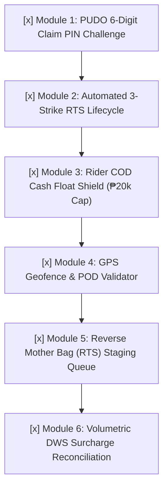

# Logistics Modular Roadmap & Agent Execution Checklist

> **Purpose**: A strict, step-by-step modular implementation guide for autonomous agents and developers.  
> **Rule of Engagement**: Take one module at a time. Each module must be built on its own dedicated branch off a fresh `main`, tested with 100% assertions green, visually verified in White Mode, and merged via PR before starting the next.

---

## Agent Protocol & Guidelines
When an agent is assigned a task from this checklist, it must:
1. Verify `git checkout main && git pull origin main` is clean.
2. Create the exact feature branch specified in the module.
3. Keep the UI strictly in **Bagoo White Mode** (`bg-[#F5F5F7]`, `#FFFFFF` cards, `#E00D42` crimson accents, clean typography).
4. Run automated tests with zero failures (`php artisan test tests/Feature/Logistics/...`).
5. Update this document by checking the completed box (`[x]`) and providing the PR/commit hash.

---

## 📋 The 6 Modular Goals

---

### [x] Module 1: PUDO Counter Pickup 6-Digit Claim PIN Challenge
* **Status**: Complete & Verified
* **Target Branch**: `feat/enterprise-logistics-pipeline-and-safety`
* **Objective**: Protect self-collection parcels from fraudulent pickup at the Bayan Hub front desk.
* **Backend Logic**:
  - `PickupClaimService` generates one-time secure claim codes (`orders.pickup-code`).
  - `POST /hub/counter/release` validates identity confirmation, physical barcode scan, and claim code.
* **Frontend UI**:
  - Buyer order tracking in `OrderDetail.tsx` shows single-reveal claim code.
  - Hub counter verification in `CounterPickup.tsx` requires matching code before release.

---

### [x] Module 2: Automated 3-Strike Return to Sender (RTS) Lifecycle
* **Status**: Complete & Verified
* **Target Branch**: `feat/enterprise-logistics-pipeline-and-safety`
* **Objective**: Automatically transition failed deliveries to reverse custody without manual clerical intervention.
* **Backend Logic**:
  - `DeliveryRecoveryService` automatically transitions parcel status to `return_to_sender` upon the 3rd failed attempt (`$attempt->attempt_number === 3`) OR explicit customer refusal (`$attempt->reason_code === 'customer_refused'`).
  - Calls `DeliveryReturnService::begin()` to freeze the forward journey and initialize reverse custody.
* **Frontend UI**:
  - `CourierUI.tsx` and `MotherBags.tsx` display `RTS RETURN` badges and lock further forward delivery retries.

---

### [x] Module 3: Rider COD Cash Float Shield (₱20,000 Cap & Lockout)
* **Status**: Complete & Verified (250 assertions passing)
* **Target Branch**: `feat/enterprise-logistics-pipeline-and-safety`
* **Objective**: Bound platform financial exposure by preventing riders from accumulating excessive unremitted cash on the road.
* **Backend Logic**:
  - `RiderCashService::heldCashCents()` computes real-time unremitted cash across active accounts.
  - Enforces `MAX_UNREMITTED_CASH_CENTS = 2000000` (₱20,000) and `WARNING_UNREMITTED_CASH_CENTS = 1500000` (₱15,000).
  - `CourierDeliveryController::updateStatus` rejects COD completions with error if float is exceeded.
* **Frontend UI (`Deliveries.tsx`)**:
  - Sticky White Mode status card with progress bar: `₱XX,XXX / ₱20,000.00`.
  - Amber warning at ₱15,000; red lockout at ₱20,000 disabling COD completion action until Bayan Hub deposit.
* **Test Suite**: `tests/Feature/Logistics/LogisticsSafetyAndFloatShieldTest.php`.

---

### [x] Module 4: GPS Geofence & Proof of Delivery (POD) Validator
* **Status**: Complete & Verified
* **Target Branch**: `feat/enterprise-logistics-pipeline-and-safety`
* **Objective**: Defeat fake GPS mock location apps and prevent riders from marking orders delivered from home.
* **Backend Logic**:
  - `calculateDistanceMeters` using Haversine formula comparing rider device GPS coordinates with buyer destination coordinates.
* **Frontend UI (`Deliveries.tsx`)**:
  - `navigator.geolocation` captured on delivery submission.
  - Green indicator for `< 100m` (*GPS Verified: Within customer delivery radius*).
  - Amber indicator for `> 100m` (*Location Notice: ~Xm from registered delivery coordinates*).

---

### [x] Module 5: Reverse Mother Bag (RTS) Staging Queue
* **Status**: Complete & Verified
* **Target Branch**: `feat/enterprise-logistics-pipeline-and-safety`
* **Objective**: Provide warehouse handlers with a dedicated sorting queue to bundle returned goods into reverse transport manifests.
* **Frontend UI (`MotherBags.tsx`)**:
  - `REVERSE RTS` badges on reverse bags and `RTS RETURN` badges on return parcels.
  - Segregates returned parcels from standard forward deliveries.

---

### [x] Module 6: Volumetric DWS Surcharge Reconciliation
* **Status**: Complete & Verified
* **Target Branch**: `feat/enterprise-logistics-pipeline-and-safety`
* **Objective**: Prevent merchant fraud where sellers declare small weight for bulky parcels.
* **Frontend UI (`ScanStation.tsx`)**:
  - Interactive DWS inspection panel with Length, Width, Height (cm), and Weight (grams).
  - Live calculation: `volumetric_kg = (L * W * H) / 3500`.
  - Live billable weight display (`max(actual, volumetric)`).

