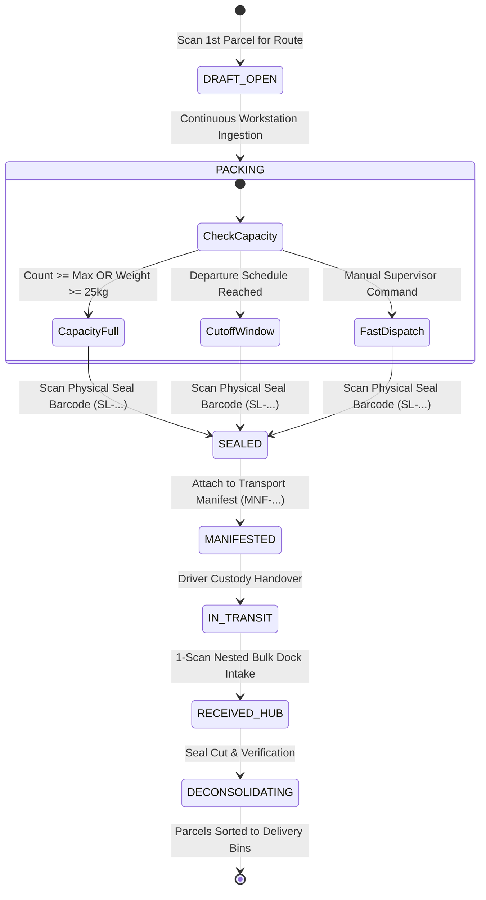

# Bagoo Enterprise Logistics: Mother Bag & Parcel Scanning Automation Specification

> **Classification**: Authoritative Engineering Architecture, Hardware-Software Integration & Station Operating Procedures (SOP)  
> **Scope**: Bulk Freight Consolidation, Mother Bag Lifecycles, Tamper-Evident Physical Seals, High-Throughput Workstation Scanning, DWS Auditing, and Conveyor Chute Operations  
> **Target Facilities**: Regional Mother Hubs (DCs) & Local Bayan / Child Hubs  
> **System Alignment**: [Master Logistics Specification](MASTER_LOGISTICS_SPECIFICATION.md), [Sorting Center Logistics Flow](SORTING_CENTER_LOGISTICS_FLOW.md), and [Logistics Architecture & Execution Plan](LOGISTICS_ARCHITECTURE_AND_EXECUTION_PLAN.md)  
> **Last Updated**: November 2026  

---

## 1. Executive Overview & Logistics Nomenclature

In enterprise parcel networks (such as J&T Express, Shopee SPX Express, Flash Express, Kerry Logistics, and SF Express), processing thousands of small packages individually at every intermediate transit dock is physically and computationally impossible. Handling packages as loose freight leads to damaged pouches, label abrasion, dock gridlock, theft, and multi-hour unloading bottlenecks.

To achieve industrial throughput, the logistics industry relies on **Consolidation Sacks**, universally termed **Mother Bags**.

```
                   [ 50–100 Individual Pouches / Boxes ]
                                    │
                                    ▼ (Poka-Yoke Workstation Scan)
                   ┌──────────────────────────────────┐
                   │   HEAVY NYLON MOTHER BAG SACK    │
                   │   • Barcode Tag: MBG-20261108-01 │
                   │   • Physical Seal: SL-889102     │
                   └──────────────────────────────────┘
                                    │
                                    ▼ (1-Scan Bulk Linehaul Manifest)
                   [ Linehaul Truck / Feeder Van Dispatch ]
```

### 1.1 Authentic Industry Terminology

| Industry Term | Alternative Industry Names | Bagoo System Identifier | Definition |
|---|---|---|---|
| **Mother Bag** | Consolidation Sack, Master Bag, Gunny Sack, Mesh Transfer Bag | `MBG-{HUB}-{DEST}-{DATE}-{SEQ}` | Heavy-duty woven polypropylene or reinforced nylon sack used to bundle 10 to 100 individual parcels destined for the same next facility. |
| **Tamper Seal** | Security Cable Tie, Indicative Plastic Pull-Tight Seal | `SL-{SERIAL}` (e.g., `SL-004921`) | Single-use numbered polypropylene locking tie that physically locks the neck of a Mother Bag. Provides indisputable chain-of-custody evidence. |
| **Master Bag Tag** | Sack Label, Mother Waybill | Barcode affixed to bag sleeve | Code 128 / QR label identifying the digital container and its next destination hop. |
| **Loose Cargo** | Non-Baggable Freight, Oversized (OD), Irregular Cargo | Standard Waybill (`BGO-...`) | Items exceeding sack dimensions or weight limits (e.g., stand fans, rice cookers, car tires). Stowed directly into the vehicle alongside Mother Bags. |
| **DWS Machine** | Dimensioner-Weigher-Scanner | Automated induction station | In-line hardware combining optical cameras, laser dimensioners, and dynamic weight scales. |
| **Chute / Rail** | Gravity Splitter, Sorter Chute | `CHUTE-{XX}` / `BIN-{XX}` | Inclined roller tracks directing parcels from the central induction line to specific destination Mother Bags. |

---

## 2. Physical vs. Digital Architecture of Mother Bags

### 2.1 The Physical Container Anatomy

```
   ┌─────────────────────────────────────────────────────────┐
   │                                                         │
   │   [ PULL-TIGHT TAMPER SEAL ]                            │
   │   Laser-engraved serial barcode: [ SL-008912 ]          │
   │   Passed through locking eyelet at sack neck            │
   │                       ╲ ╱                               │
   │                        █                                │
   │                  ═════════════                          │
   │                 /             \                         │
   │                /   TRANSPARENT \                        │
   │               │   DOCUMENT SLEEVE                       │
   │               │  ┌───────────┐  │                       │
   │               │  │ MASTER TAG│  │                       │
   │               │  │ MBG-LP-01 │  │                       │
   │               │  └───────────┘  │                       │
   │               │                 │                       │
   │               │ HEAVY NYLON /   │                       │
   │               │ WOVEN PP SACK   │                       │
   │               │ (Cap: 25-30 kg) │                       │
   │               \                 /                       │
   │                \               /                        │
   │                 ═══════════════                         │
   │                                                         │
   └─────────────────────────────────────────────────────────┘
```

1. **Sack Material**: Tear-resistant 1000D woven polypropylene or ballistic nylon with reinforced bottom stitching, resistant to road vibration, moisture, and rough sorting slides.
2. **Transparent Document Sleeve**: Clear PVC pocket heat-sealed to the outer wall holding the printed Master Bag Tag (`MBG-...`) or destination placard.
3. **Neck Eyelet & Security Cable Tie**: A reinforced collar through which the single-use plastic seal (`SL-...`) is pulled tight. Once ratcheted shut, it cannot be loosened without cutting the cable.

### 2.2 Dynamic Capacity vs. Rigid Parcel Counts

A Mother Bag does **not** have an arbitrary fixed limit of 50 parcels:
- **Volumetric Density Variance**:
  - Small e-commerce pouches (phone cases, cosmetics, memory cards): A 100-liter sack can fit **80 to 120 parcels**.
  - Medium shoeboxes and winter jackets: A 100-liter sack reaches capacity at **15 to 25 parcels**.
- **Occupational Health & Safety (OSH) Weight Thresholds**:
  - Manual warehouse handling standards cap individual bag weight at **25.0 kg to 30.0 kg**.
  - Exceeding 30 kg triggers physical injury risks for dock workers during vehicle loading.
- **Loose Cargo Classification**:
  - Any single item exceeding **60 cm on any side** or **15.0 kg individually** is tagged as non-baggable. It bypasses the Mother Bag queue and is loaded as individual loose cargo on the transport manifest.

### 2.3 Physical Seals: Origin, Barcoding & Lifecycle

Logistics operators do not print plastic seals at the workstation. Physical seals are industrial hardware supplies:
1. **Procurement**: Seals are manufactured in serialized rolls of 1,000 (e.g., `SL-008000` to `SL-008999`) with hot-stamped or laser-engraved Code 128 barcodes.
2. **Workstation Dispenser**: Operators keep a rack of seals at the packing bench.
3. **Digital Binding**: When a bag reaches capacity or the scheduled dispatch cut-off, the operator wraps the seal around the bag neck, pulls it tight, and scans the seal's laser-engraved barcode. The system binds:
   $$\text{Seal Serial Number} \longleftrightarrow \text{Mother Bag ID} \longleftrightarrow [\text{Parcel } 1, \dots, \text{Parcel } N]$$

---

## 3. Automation Engines: Sealing Triggers & One-Scan Ingestion

In real hubs, Mother Bags transition between states based on deterministic physical and temporal triggers.



### 3.1 The Three Sealing Triggers

| Trigger Type | Operational Cause | Automation Action |
|---|---|---|
| **1. Volume / Weight Threshold** | Bag reaches 50 pouches or 25.0 kg limit. | Workstation audio sounds double chime (`STATUS_READY_TO_SEAL`). Active packing buffer is locked; system opens the next serial bag (`MBG-...-02`) automatically for that chute. |
| **2. Scheduled Departure Cut-off** | Feeder truck or linehaul departure window arrives (e.g., 09:00 AM, 01:30 PM, 05:30 PM, 11:00 PM). | System locks all open destination bags for that route regardless of parcel count (even if holding only 8 parcels). Trucks operate on schedule; freight cannot wait for bags to be full. |
| **3. On-Demand Fast Dispatch (`fastDispatch`)** | High-priority express flow or end-of-shift clearing. | Operator triggers `[CMD-DISPATCH]` hotkey. System converts all current staging items into a sealed bag, prints the master tag, and stages for manifest generation. |

### 3.2 The 1-Scan Nested Bulk Dock Ingestion Architecture

In loose parcel operations, an L300 van containing 800 parcels requires 800 individual barcode scans at the destination unloading dock, consuming 45 to 60 minutes while the truck occupies the unloading bay.

With Bagoo Mother Bag architecture:
1. The linehaul truck arrives with **12 Mother Bags** containing those 800 parcels.
2. The dock receiving clerk scans **12 Master Bag Tags** (`MBG-...`) or **Tamper Seals** (`SL-...`).
3. Total dock clearance time: **45 seconds**.

#### Nested Database Transaction Model

When a Master Bag Tag is scanned at an inbound hub, the database performs an atomic recursive update:

```sql
-- Single Atomic Ingestion Execution
UPDATE parcels 
SET 
    current_facility_id = :receiving_facility_id,
    status = 'at_hub',
    last_scanned_at = NOW(),
    updated_at = NOW()
WHERE mother_bag_id = (
    SELECT id FROM mother_bags WHERE barcode = :scanned_bag_barcode
);

-- Record Inbound Facility Ledger Event
INSERT INTO parcel_facility_events (parcel_id, facility_id, event_type, created_at)
SELECT id, :receiving_facility_id, 'INBOUND_MOTHER_BAG_RECEPTION', NOW()
FROM parcels 
WHERE mother_bag_id = :target_mother_bag_id;
```

Zero parcels are left in indeterminate state; all 80 child waybills immediately reflect arrival at the facility on buyer tracking screens.

---

## 4. Sorting Facility Physical Flow & Assembly Line Stations

Hub operations divide labor across specialized mechanical and physical zones. A single worker does not perform every step; packages move through an automated pipeline.

```
[ UNLOADING BAY ]
       │
       ▼
[ STATION 1: Conveyor Induction & DWS Scale ]
       │  (Continuous laser optical scan, dynamic weighing, optical profiling)
       ▼
[ CONVEYOR BELT / GRAVITY ROLLER RUN ]
       │
       ├─────────────────────┬─────────────────────┐
       ▼ (Chute 1)           ▼ (Chute 2)           ▼ (Chute 3)
[ STATION 2: Sort Bay A ] [ STATION 2: Sort Bay B ] [ STATION 2: Sort Bay C ]
(San Pablo Child Hub)     (Calamba Child Hub)      (Regional Mother Hub)
       │                             │                             │
       ▼                             ▼                             ▼
[ MOTHER BAG: MBG-SP ]       [ MOTHER BAG: MBG-CAL ]      [ MOTHER BAG: MBG-RMH ]
       │                             │                             │
       └─────────────────────┬─────────────────────┘
                             ▼
              [ STATION 3: Dispatch & Staging ]
     (Attach Seal SL-..., Master Tag print, Linehaul Manifest)
                             │
                             ▼
                     [ LOADING BAY ]
```

### 4.1 Station Role Matrix

| Station Number & Name | Equipment & Hardware | Physical Operations Performed | Software Interaction |
|---|---|---|---|
| **Station 1: Inbound Induction & DWS** | Overhead omnidirectional barcode scanner, in-motion dynamic scale, optical light curtains. | Operator places packages face-up on the intake belt. System validates weight/dimensions against merchant manifest. | `Continuous Scan: ON`. Auto-validates waybill in < 300ms. Calculates dimensional weight and flags billing surcharges. |
| **Station 2: Chute Sorting & Bagging** | Gravity roller chutes, ring barcode scanners, mobile tablet or fixed industrial terminal, bag racking frames. | Packages slide down destination chutes. Worker scans parcel barcode, verifies bin display, drops item into destination Mother Bag. | Poka-Yoke chute match. Increments bag count and weight gauge. Prompts seal scan upon threshold breach. |
| **Station 3: Bag Sealing & Manifesting** | Heavy-duty zip seal dispensers, industrial thermal label printer (4x6"), dock dispatch terminal. | Operator pulls bag off frame, loops plastic seal through eyelet, scans seal barcode, prints Master Bag Tag, and places bag on pallet. | `fastDispatch` / `POST /hub/mother-bags/{id}/seal`. Adds Mother Bag to vehicle e-BOL (`LogisticsManifest`). |
| **Station 4: Outbound Linehaul Loading** | Handheld rugged PDA (Zebra/Honeywell), pallet jacks, dock levelers. | Loader scans pallet/Mother Bag onto designated freight truck or L300 van. | Verifies vehicle capacity limit and locks transport manifest upon driver sign-off. |

---

## 5. Workstation Ergonomics: Continuous Scan Mode & Poka-Yoke

In high-throughput sorting centers, any software workflow that requires a worker to switch from a physical package to a desktop mouse or keyboard destroys productivity.

### 5.1 Continuous Scan Mode (Sub-300ms Intake)

Standard CRUD interfaces stop on an inspection modal:
$$\text{Scan} \longrightarrow \text{Wait for Modal} \longrightarrow \text{Move Mouse} \longrightarrow \text{Click "Confirm"} \longrightarrow \text{Next Scan}$$
*Throughput*: **150 parcels / hour** (inefficient).

Bagoo Continuous Scan Mode ([ScanStation.tsx](file:///home/andy/Projects/bagoo/resources/js/Pages/Hub/ScanStation.tsx)):
$$\text{Scan} \longrightarrow \text{Autonomous Server Atomic Transaction} \longrightarrow \text{Audio/Visual Feedback} \longrightarrow \text{Ready Buffer (< 300ms)}$$
*Throughput*: **1,200 to 1,800 parcels / hour**.

```
[ BARCODE DETECTED ] ──> [ Audio Chime: BEEP ] ──> [ POST /hub/scan/continuous ]
                                                            │
                                  ┌─────────────────────────┴─────────────────────────┐
                                  ▼                                                   ▼
                         (200 OK: Valid Route)                               (422 Error: Misroute)
                                  │                                                   │
                          [ GREEN FLASH ]                                     [ RED STROBE ]
                          [ CHIME: SUCCESS ]                                  [ SIREN: REJECT ]
                          [ Display: BIN-04 ]                                 [ Trap Chute Opened ]
```

### 5.2 Two-Way Poka-Yoke Bin Verification

To prevent human error where an operator drops a parcel into the wrong destination bag:
1. Operator scans waybill barcode (`BGO-7749102`).
2. Terminal screen displays target destination in high-contrast Bagoo typography:
   $$\text{SLOT: } \mathbf{CHUTE\ 03\ -\ SAN\ PABLO\ BAYAN\ HUB}$$
3. Operator drops parcel into the bag mounted under Chute 03.
4. *Two-Way Verification Step*: Operator scans the physical barcode printed on Chute 03 (`BIN-SP-03`).
5. If the operator scans Chute 02 instead, the terminal flashes crimson (`#E00D42`), triggers an audible buzzer, and refuses to register the custody step until corrected.

### 5.3 Shared Terminal Scopes vs. Personal Accounts

Logistics centers operate on 3-shift 24-hour cycles. Creating 100 personal administrative accounts for temporary warehouse handlers is an operational and security hazard:
- **Workstation Identity**: Terminals run in **Hardware Station Mode** bound to a specific facility (`facility_id`) and physical desk (`station_code: BGR-STN-02`).
- **Shift Badging**: Workers scan their physical employee ID badge to take control of an active workstation session.
- **Concurrent Integrity**: Multiple sorting lanes can pack Mother Bags for the same destination simultaneously without race conditions or database row locks.

---

## 6. Vehicle Fleet Capacity & Loading Profiles

A common logistical misconception is that cargo vans are loaded with loose packages. In reality, vehicles are packed strictly with modular Mother Bags and designated loose cargo pallets.

```
+-------------------------------------------------------------------+
|               CABIN / DRIVER COMPARTMENT (2 Crew)                 |
+-------------------------------------------------------------------+
|                            CARGO BED                              |
|                                                                   |
|  [MBG 01: San Pablo]  [MBG 02: San Pablo]  [MBG 03: Calamba]      |
|  [MBG 04: Calamba]    [MBG 05: Los Baños]  [MBG 06: Los Baños]    |
|  [MBG 07: Sta. Cruz]  [MBG 08: Sta. Cruz]  [MBG 09: Pagsanjan]    |
|  [MBG 10: Bay]        [MBG 11: Alaminos]   [MBG 12: Reverse RTS]  |
|                                                                   |
|  ---------------- LOOSE BULK FREIGHT SECTION -------------------  |
|  [Loose: Rice Cooker]   [Loose: Microwave]   [Loose: 32" TV]      |
+-------------------------------------------------------------------+
```

### 6.1 Fleet Vehicle Capacity Matrix

| Vehicle Class | Primary Route Type | Mother Bag Capacity | Loose Parcel Capacity (Bags + Loose) | Max Payload (kg) | Dock Turnaround Time |
|---|---|---|---|---|---|
| **Motorcycle / Cargo Trike** | First-Mile Pickup / Last-Mile Doorstep | 0–1 (Split bags) | 30–60 small pouches | 120 kg | 5 mins |
| **L300 / Cargo Van** | Child Hub to Child Hub Feeder | 12–16 Mother Bags | 600–900 parcels | 1,000 kg | 12 mins |
| **4-Wheeler Closed Van** | Child Hub to Regional Mother Hub | 25–35 Mother Bags | 1,500–2,200 parcels | 2,500 kg | 20 mins |
| **6-Wheeler Forward Truck** | Inter-Cluster Linehaul (Mother to Mother) | 60–80 Mother Bags | 3,500–5,000 parcels | 6,000 kg | 35 mins |
| **10-Wheeler Wing Van** | Trunk Linehaul Expressway Routes | 120–160 Mother Bags | 8,000–12,000 parcels | 15,000 kg | 45 mins |

---

## 7. Fleet Vehicle Assignment Automation & Dispatch Engine (TMS)

Logistics operations do not rely on warehouse supervisors manually guessing which truck or driver to dispatch. The assignment of vans and linehaul trucks is fully automated through an algorithmic **Transportation Management System (TMS) / Linehaul Dispatch Engine**.

```
[ REAL-TIME BAGGING & DWS ACCUMULATION ]
  • Total Actual Weight: 780 kg
  • Total Volumetric Space: 5.6 CBM
  • Route: San Pablo Child Hub ──> South Luzon Regional Mother Hub
                               │
                               ▼
[ 1. ALGORITHMIC CAPACITY SIZING (BIN-PACKING) ]
  • Evaluates vehicle class envelopes (kg, CBM, bag count)
  • Optimal Match: "L300 Cargo Van" (prevents wasting a 6-wheeler)
                               │
                               ▼
[ 2. DRIVER & VEHICLE SELECTION ENGINE ]
  • Model A: Active Shift Roster (Child Hubs)
  • Model B: FIFO Staging Yard Turno Queue (Mother Distribution Centers)
  • Assigned: Van Plate NDK-1829 / Driver Carlos Mendoza
                               │
                               ▼
[ 3. ELECTRONIC MANIFEST (e-BOL) BINDING ]
  • Manifest MNF-20261108-03 generated atomically
  • Binds 14 Mother Bags + 4 Loose Cargo items to vehicle
                               │
                               ▼
[ 4. DOCK BAY DISPATCH & QR GATE PASS ]
  • Yard overhead LED displays: "Plate NDK-1829 ──> Dock Bay 04"
  • Driver inspects seals and signs digital e-BOL on mobile terminal
  • Guardhouse gate scans QR Gate Pass; boom barrier opens
```

### 7.1 Real-Time Demand Aggregation (Weight & CBM)

As parcels are scanned into Mother Bags and non-baggable cargo is staged, the backend continuously aggregates three live metrics for every destination corridor:
1. **Actual Weight ($W_{\text{act}}$)**: Live sum from the in-line dynamic DWS scale.
2. **Volumetric Space ($V_{\text{CBM}}$)**: Calculated as $\sum \frac{L \times W \times H}{1,000,000}$ for all loose items plus the standardized volume profile of each sealed Mother Bag ($0.30\ \text{CBM}$ per 100L sack).
3. **Container Count**: Number of sealed Mother Bags plus loose oversized cartons.

30 to 45 minutes prior to the scheduled departure cut-off window, the system evaluates the corridor load against available fleet assets.

### 7.2 Automated Vehicle Sizing Algorithm

The system runs a bin-packing optimization to assign the lowest-cost vehicle class that meets the volume and weight demands with a 10% safety buffer:

$$\text{Selected Class} = \min_{\text{class} \in \text{Fleet}} \left\{ \text{Cost}(\text{class}) \;\middle|\; \text{Payload}_{\text{class}} \ge 1.10 \times W_{\text{act}} \quad\text{and}\quad \text{CBM}_{\text{class}} \ge 1.10 \times V_{\text{CBM}} \right\}$$

- **Standard Load ($\le 850\ \text{kg}$, $\le 5.5\ \text{CBM}$)**: The system dispatches an **L300 Cargo Van**.
- **Double-Day / Campaign Spike ($\ge 1,500\ \text{kg}$, $\ge 12\ \text{CBM}$)**: The system **auto-upgrades** the assignment to a **4-Wheeler Closed Van** or schedules a **second L300 overflow shuttle** without human clerical intervention.

### 7.3 Driver & Plate Binding Models

| Facility Type | Operating Model | Assignment Mechanism |
|---|---|---|
| **Child / Bayan Hubs** | **Fixed Shift Rostering** | Regular daily feeder trips run on scheduled rosters. The system checks which driver/plate is on shift for that wave (e.g. *Driver Carlos Mendoza, Plate NDK-1829*) and binds them directly to the `LogisticsManifest`. |
| **Regional Mother Hubs (DCs)** | **FIFO Staging Yard Queue ("Turno")** | Linehaul trucks check in at the guardhouse upon arrival and enter a virtual queue. When the sorter completes a manifest for a route, the system broadcasts a **Dock Bay Call** via SMS and yard display screens calling the next matching truck to the loading bay. |

### 7.4 Dock Verification, Digital e-BOL & QR Gate Pass

1. **Anti-Misload Dock Scan (`ERR_TRUCK_MISLOAD`)**: As loaders move Mother Bags from staging into the vehicle, a handheld scanner reads each sack barcode. If a bag destined for Batangas is scanned into a truck bound for Laguna, the scanner sounds an immediate alarm and locks the loading sequence.
2. **Digital Custody Sign-Off**: The driver conducts a visual check of the tamper seals (`SL-...`), verifies the total container count on the driver mobile app, and signs the electronic Bill of Lading (e-BOL). The manifest status flips from `DRAFT` to `IN_TRANSIT`.
3. **Automated Exit Gate Pass**: The system generates a single **QR Gate Pass** on the driver's phone. At the facility exit gate, the guardhouse optical scanner verifies the gate pass against the live manifest database, records the departure timestamp, and triggers the motorized boom barrier to open.

---

## 8. Transport Dispatch Schedules & Waves

Linehaul vehicles do not depart only at the end of the working day (5:00 PM). Doing so would overwhelm destination sorting hubs with massive midnight bottlenecks. Enterprise networks run **Multi-Wave Dispatch Windows**.

```
  08:00 AM          12:30 PM          05:30 PM          11:00 PM
  WAVE 1            WAVE 2            WAVE 3            WAVE 4
  Morning Feeder    Mid-day Shuttle   Evening Rush      Night Trunkline
  ┌──────────────┐  ┌──────────────┐  ┌──────────────┐  ┌──────────────┐
  │ First-mile   │  │ Same-Day     │  │ Peak Seller  │  │ Inter-DC     │
  │ seller drops │  │ inter-city   │  │ drop-offs &  │  │ heavy wing   │
  │ to Mother DC │  │ feeder runs  │  │ Bayan feeder │  │ vans to North│
  └──────────────┘  └──────────────┘  └──────────────┘  └──────────────┘
```

1. **Wave 1 (08:00–09:30 AM) - Morning Feeder**: Clears parcels processed by overnight sorting shifts out to destination Child Hubs for morning rider last-mile staging.
2. **Wave 2 (12:30–01:30 PM) - Mid-day Cross-Dock**: Moves morning merchant drop-offs and same-day inter-municipal transfers between adjacent towns.
3. **Wave 3 (05:00–06:30 PM) - Evening Peak Linehaul**: Consolidates daytime merchant collections across all Bayan Hubs and feeds them into Regional Sorting Distribution Centers.
4. **Wave 4 (11:00 PM–01:00 AM) - Overnight Heavy Trunkline**: High-capacity wing vans travel expressway trunks (SLEX/NLEX) between regional mega-DCs while highway traffic is minimal.

---

## 9. Exception Handling & Security Protocols

### 9.1 Broken or Mismatched Tamper Seals (`SECURITY_SEAL_VIOLATION`)

If a Mother Bag arrives at an inbound dock with a severed seal, missing seal, or a barcode that does not match the driver's electronic transport manifest:
1. **Quarantine Lockout**: The system blocks automated 1-scan nested acceptance.
2. **Discrepancy Incident Report**: The receiving dock supervisor must take high-resolution photographic evidence and log an incident report against the linehaul transport driver.
3. **Itemized Audit Scan**: Every parcel inside the bag must be unbagged and scanned individually.
4. **Discrepancy Manifest**:
   - Any missing parcel triggers an immediate insurance theft claim.
   - Any unmanifested foreign parcel is routed to the inspection security cage (`TRAP_FOREIGN_CARGO`).

### 9.2 Misroute Intercept Trap (`ERR_MISROUTE_INTERCEPT`)

If a parcel destined for Child Hub B (e.g., Sta. Cruz) is scanned into a Mother Bag destined for Child Hub C (e.g., San Pablo):
- The terminal emits an urgent red visual flash and high-frequency audio tone.
- The conveyor diverter gate kicks the package into the **Exception Chute**.
- The database logs a `MISROUTE_PREVENTED` metric against the operator station for quality auditing.

### 9.3 Anti-Backhaul Guard

Parcels cannot be manifested or bagged in reverse direction along their delivery route unless the parcel has explicitly transitioned into an authorized **Return to Sender (RTS)** or **Buyer Return** state. Forward journey packages scanned backwards are blocked to prevent systemic circular routing loops.

### 9.4 Empty Mother Bag Recycling & Logistics

Mother Bags are high-grade physical assets (costing $8 to $15 per nylon sack) and are not discarded after a single trip:
1. Once de-consolidated and unpacked at a destination Child Hub, empty bags are inspected for tears.
2. Bags are folded flat, stacked in bundles of 10, and bound with a return utility strap.
3. Return bundles are manifested as zero-tariff equipment backhaul (`EQUIPMENT_RETURN_BUNDLE`) and shipped back to origin hubs on returning empty trucks.

---

## 10. Verification & Codebase Cross-Reference

| System Function | Implementing Source Component |
|---|---|
| Continuous Workstation Scanning | [ScanStation.tsx](file:///home/andy/Projects/bagoo/resources/js/Pages/Hub/ScanStation.tsx#L140-L240) |
| Mother Bag Digital Registry & Fast Dispatch | [MotherBags.tsx](file:///home/andy/Projects/bagoo/resources/js/Pages/Hub/MotherBags.tsx#L85-L160) |
| Electronic Transport Manifest (e-BOL) | [LogisticsManifest.tsx](file:///home/andy/Projects/bagoo/resources/js/Pages/Hub/LogisticsManifest.tsx) |
| Waybill Camera & Hardware Barcode Engine | [WaybillCamera.tsx](file:///home/andy/Projects/bagoo/resources/js/Components/WaybillCamera.tsx) |
| Counter PUDO 6-Digit Claim Verification | [CounterPickup.tsx](file:///home/andy/Projects/bagoo/resources/js/Pages/Hub/CounterPickup.tsx) |
| Core Hub-and-Spoke Topology & Routing Engine | [LogisticsRoutingEngine.php](file:///home/andy/Projects/bagoo/app/Services/LogisticsRoutingEngine.php) |
| Interactive Visual Simulation (Induction & Sorter) | [bagoo-hub-logistics-flow.html](file:///home/andy/Downloads/bagoo-hub-logistics-flow.html) |
