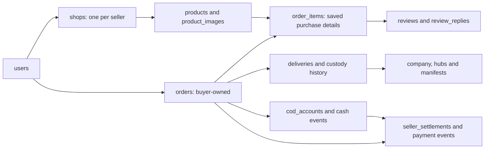

# BagooPH Database Schema Guide

Verified against current migrations and models on October 16, 2026. A disposable
SQLite `:memory:` migration inspection produced **98 tables**, including Laravel
infrastructure. No development or production database was migrated, queried or
reset for this documentation review.

This is a supporting data map and complete table-name inventory, with selected
important columns. [Migrations](../database/migrations) and [models](../app/Models)
remain the full executable definition. SQLite inspection does not prove
PostgreSQL-specific types, triggers, row locks or the deployed migration state.
See [architecture](ARCHITECTURE.md), [the verified stack](TECH_STACK.md) and
[the validation contract](CORE_FLOW_VALIDATION_AND_EDGE_CASES.md) for boundaries.

## Main relationships

The diagram describes application relationships. Exact foreign keys, nullable
legacy references and uniqueness constraints must be read from migrations.
For example, shop ownership has a unique `user_id` constraint; the ordinary
checkout creates one parcel per generated shop order, which is also an
application invariant rather than a claim that every illustrated edge has a
unique database constraint.

## Identity and reviewed scope

`users` stores five fixed account roles: `buyer`, `seller`, `courier`,
`logistics`, `admin`. Personal name components use `first_name`, `middle_name`
and `last_name`; the stored demographic field is `sex`. `name` is retained for
combined-name compatibility. Approval, activity, identity revision and closure
are separate records/fields, not a single permission flag.

Original sign-in identity and verified additional email addresses use
`account_emails` and the user contact preference. Private identity/licence/OR-CR
paths are user fields; the courier profile holds vehicle and assignment details.
KYC, corrections, shop review, restrictions and closure retain their own
source-bound decisions. A table/field's presence does not grant direct owner
editing of reviewed evidence.

## Commerce and product snapshots

A seller's sole `shops` row carries its reviewed master category and current
review decision. `categories` contains parent/child records; the **14 master
categories are seed/application policy**, not a limit of 14 total category rows.
`products.variants` stores variant structure as JSON through the model; there
is no separate `product_variations` table in this inspected schema.

Shopping Bag quantities live in `cart_items`. Checkout writes independent
`orders` and `deliveries` per shop, with item colour/size/SKU and price snapshots.
`checkout_submissions` and `checkout_submission_orders` retain a successful
confirmation result for retries. `buy_again_submissions` retains its separate
Bag-addition result. Saved addresses apply to future purchases; original order
recipient snapshots are retained.

New checkout uses COD. Old strings or flexible SQL column types do not establish
card, wallet or bank-payment support. Canonical commercial statuses come from
`OrderStatus` and the lifecycle service; legacy aliases exist for compatibility
and are not new allowed operational transitions. `CANCELLED` is a separate
terminal commercial outcome. A delivery's internal status/checkpoints can be
more detailed than the customer-facing order state.

`reviews.order_item_id` binds new verified reviews to completed owned purchases,
with a unique index. Legacy review rows are not evidence of a current verified
purchase. Replies use `review_replies` and retain seller/shop ownership.

## Custody and finance

Company/facility placement, manifests, actual checkpoint events, delivery
attempts, reviewed recovery, secure counter claims and handover issues have
separate persisted sources. Courier pickup and final-mile assignments are
separate parcel references; neither is another stored account role.

`cod_accounts` and `cod_cash_events` track expected cash, custody, counted
handovers, differences and reconciliation. `cod_custody_entries` retains counter
cash source evidence. `seller_settlements` and `seller_settlement_events` bind
buyer completion, reconciled cash and recorded seller payment. Monetary ledgers
use explicit integer-cent fields where defined; older decimal compatibility
fields remain in `commission_ledgers`.

The product split is 90% seller and 10% platform. Shipping and promotional
funding remain separately recorded. A compatibility commission row does not
prove collected cash, buyer completion or a paid seller. The inspected table
is `commission_ledgers`, not a separate `commissions` table. The former schema
also described a `disputes` table; it is not present in this migrated schema,
and the current returns/disputes pages do not implement refund processing.

## Selected important columns

These are actual column names, not an exhaustive column/type/default listing.

### `users`

`first_name`, `middle_name`, `last_name`, `name`, `sex`, `email`, `phone`, `birthday`, `age`, `role`, `status`, `kyc_status`, `identity_version`, `restriction_version`, `closed_at`, `preferred_contact_email_id`, `id_document_path`, `business_permit_path`, `driver_license_path`, `or_cr_path`.

### `shops`

`user_id`, `root_category_id`, `name`, `address`, `phone`, `status`, `review_status`, `review_version`, `review_decision_id`.

### `courier_profiles`

`user_id`, `vehicle_type`, `plate_number`, `license_number`, `is_available`, `logistics_company_id`, `assigned_hub_id`, `assigned_barangay`, `vehicle_id`.

### `products`

`shop_id`, `category_id`, `price`, `stock`, `sku`, `variants`, `status`, `compliance_restricted`, `moderation_version`.

### `orders`

`buyer_id`, `subtotal`, `shipping_fee`, `voucher_discount`, `total_amount`, `payment_method`, `payment_status`, `status`, `recipient_name`, `recipient_phone`, `shipping_address`, `shipping_city`, `shipping_province`, `shipping_postal_code`, `destination_barangay`, `destination_latitude`, `destination_longitude`, `delivery_type`, `pickup_hub_id`, `completed_at`.

### `order_items`

`order_id`, `product_id`, `shop_id`, `quantity`, `unit_price`, `subtotal`, `color`, `size`, `sku_snapshot`.

### `deliveries`

`order_id`, `tracking_number`, `courier_id`, `assigned_rider_id`, `status`, `logistics_company_id`, `origin_bayan_hub_id`, `origin_mother_hub_id`, `destination_mother_hub_id`, `destination_bayan_hub_id`, `current_hub_id`, `delivery_type`, `failure_attempts`, `proof_image`.

### `reviews`

`order_item_id`, `product_id`, `buyer_id`, `order_id`, `rating`, `comment`, `images`, `submission_fingerprint`.

### `cod_accounts`

`order_id`, `delivery_id`, `source_kind`, `product_subtotal_cents`, `discount_cents`, `shipping_cents`, `expected_cents`, `version`, `state`, `reconciled_at`.

### `seller_settlements`

`order_id`, `seller_id`, `shop_id`, `cod_account_id`, `reconciliation_event_id`, `buyer_checkpoint_id`, `product_cents`, `seller_cents`, `commission_cents`, `shipping_cents`, `seller_promotion_cents`, `platform_promotion_cents`, `net_seller_cents`, `net_commission_cents`.

## Complete inspected table inventory

Every table name below was present after isolated migrations. Grouping explains
responsibility; it does not claim that every persisted field has a public UI or
that the live server has applied every migration.

### Accounts, authentication and governance

`users`, `account_emails`, `account_policy_acceptances`, `email_otps`, `password_reset_tokens`, `personal_access_tokens`, `sessions`, `kyc_decisions`, `identity_correction_requests`, `identity_correction_decisions`, `account_closures`, `restriction_decisions`, `restriction_affected_work`, `governance_guards`.

### Catalogue, shop review and purchase feedback

`shops`, `shop_review_decisions`, `categories`, `products`, `product_images`, `product_moderation_decisions`, `reviews`, `review_replies`, `saved_products`.

### Shopping Bag, addresses and checkout

`addresses`, `carts`, `cart_items`, `orders`, `order_items`, `checkout_submissions`, `checkout_submission_orders`, `buy_again_submissions`.

### Vouchers and funding

`voucher_campaign_actions`, `voucher_campaign_drafts`, `voucher_funding_entries`, `voucher_order_allocations`, `voucher_redemptions`, `voucher_revision_balances`, `voucher_revisions`, `vouchers`, `saved_vouchers`.

### Company and facility placement

`courier_profiles`, `logistics_companies`, `logistics_hubs`, `logistics_fleet`, `hub_handlers`, `logistics_placement_records`.

### Parcel custody, recovery and counter collection

`deliveries`, `delivery_checkpoints`, `delivery_attempts`, `delivery_recovery_events`, `delivery_return_routes`, `delivery_return_events`, `logistics_manifests`, `logistics_manifest_parcels`, `logistics_manifest_events`, `pickup_claims`, `pickup_claim_events`, `parcel_recovery_cases`, `parcel_recovery_events`, `custody_recovery_grants`, `custody_recovery_receipts`, `exception_decisions`, `handover_issues`, `handover_issue_events`, `handover_recovery_grants`, `handover_manifest_receipts`.

### Native commands and rider company joining

`rider_commands`, `rider_company_consents`, `rider_company_intake_events`, `rider_company_offers`, `rider_company_request_events`, `rider_company_requests`, `rider_company_scope_changes`.

### Cash and seller settlement

`cod_accounts`, `cod_cash_events`, `cod_custody_entries`, `seller_settlements`, `seller_settlement_events`, `commission_ledgers`.

### Owned messages and notifications

`messages`, `notifications`, `notification_deliveries`.

### Advertisements

`advertisement_actions`, `advertisement_assets`, `advertisement_daily_statistics`, `advertisement_events`, `advertisement_publications`, `advertisement_reviews`, `advertisement_revisions`, `advertisement_schedule_locks`, `advertisement_submissions`, `advertisements`.

### Framework infrastructure

`cache`, `cache_locks`, `jobs`, `job_batches`, `failed_jobs`, `migrations`.

## Source and verification notes

- The inspection booted the current Laravel application in `testing`, required
  `database.default=sqlite` and `database=:memory:`, and refused other settings
  before running migrations. It used a separate configuration/storage path.
- Tables, columns, indexes and foreign keys were inspected through Laravel's
  schema API. Selected column names and the complete table-name inventory were
  checked against that output, then related policy was checked in models/services.
- PostgreSQL remains the Compose application database. This review did not run
  PostgreSQL migrations, a concurrency test, a data reset or deployment.
- The framework's session/cache/job tables support their configured drivers;
  their presence does not establish an operating worker or scheduler.
- Planned additions belong in [the roadmap](CORE_FLOW_ROADMAP.md) until
  implemented. A schema guide cannot substitute for permission or lifecycle
  checks in the backend services.
