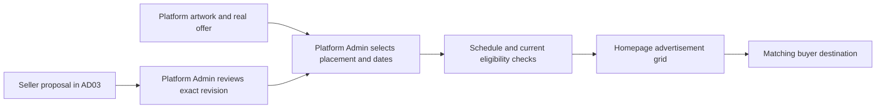

# Advertisement Management Plan

Proposal prepared October 15, 2026. This is planning, not implemented management
or authorization to build every batch. Follow the system, buyer, seller and
admin contracts in [the documentation map](../README.md). The current code audit
and implementation evidence remain in [the roadmap](../CORE_FLOW_ROADMAP.md).

## Recommended first release

Let an active Platform Admin upload and manage marketplace advertisements. An
advertisement is an image, an approved destination and a display schedule; it
does not create a product discount or voucher. Start with curated placements
without advertising fees. Add seller submissions after the admin and buyer flow
works. Keep existing seller shop branding editable by its owner.

Preserve the chosen buyer layout: three slides in the larger left carousel and
two smaller images on the right on desktop, with arrows inside the main image.
Smaller screens place the supporting images below. Keep the section within the
buyer content width, without colorful shortcut tiles, card borders, caption bars
or advertisement text footers. Keep each portal's existing style.

## Who creates, uploads and manages it

| Person or existing role | Responsibility | Boundary |
|---|---|---|
| Platform owner or project team | Chooses the campaign purpose, products, dates and artwork message. | Planning an offer does not activate a discount. |
| Designer or team member | Produces the image outside the application and gives it to the uploader. | A separate designer account or paid design service is unnecessary. |
| Active Platform Admin | Uploads platform artwork, chooses the destination and placement, previews, schedules, publishes, pauses and ends it. Reviews later seller submissions. | Reuse marketplace governance authority; a logistics administrator does not gain this power just because its title contains admin. |
| Eligible seller | Edits the existing branding of its one shop. In AD03, uploads a proposed promotion for its own eligible products, shop or shop voucher and sees review feedback. | Cannot publish into the marketplace homepage, advertise another seller's products or change approved content in place. |
| Buyer or guest | Views advertisements and opens the matching destination. | Saving vouchers and purchasing retain existing authentication and approval rules. |
| Courier, company administrator or hub handler | No advertisement management responsibility. | Operational account access does not grant marketplace editorial authority. |
| Application services | Apply saved schedules, current eligibility and immediate pause/expiry rules. | No fabricated offer, extra account role or automatic checkout action. |

An admin may create and publish its own editorial promotion, with retained
history. A second administrator is not mandatory for this first release. Seller
submissions require a recorded Platform Admin decision on the exact submitted
revision. These are Bagoo choices, not claims about another company's staffing.

## Advertisement types and where they belong

| Type | Who supplies and controls it | Display and click destination | Delivery |
|---|---|---|---|
| Platform event or collection | Platform team supplies; Platform Admin publishes. | Homepage main carousel or side image; opens a dedicated event/collection page with matching products and real terms. | AD01 + AD02 |
| Category or product feature | Platform Admin curates eligible content. | Homepage image; opens the selected category results or product details. Additional category-page ad slots are deferred. | AD01 + AD02 |
| Shop feature | Platform Admin curates, or seller supplies for later review. | Homepage image; opens that approved shop's public storefront. | AD02; seller supply in AD03 |
| Voucher promotion | Issuer manages the actual voucher; admin manages the image and placement. | Opens readable offer terms and related products, then the existing buyer voucher collection when needed. | AD02 |
| Own-shop branding | Seller manages its existing logo/banner and description. | Appears on its public storefront; it is not a purchased homepage slot. | Preserve existing behavior |
| Seller-requested marketplace feature | Seller submits; Platform Admin reviews, schedules and places it. | Approved homepage placement; opens the submitted, approved destination. | AD03 |
| Sponsored search/product listing | Seller would choose products and a paid campaign under separate policies. | Search or product-discovery results, clearly identified if ever introduced. | Deferred |
| Offsite, affiliate, video, live, push or email advertising | Would need additional channels, permissions and measurement. | Outside the initial homepage/storefront flow. | Deferred |

Organic New Arrivals, ratings and Best Sellers are catalogue filters, not paid
advertisements. Do not sell their ordering or label them sponsored in this plan.
Do not put promotional inventory on login, registration, checkout confirmation,
account verification, order recovery or courier/hub operational screens.

## What a click should do

| Chosen target | Buyer experience | Existing integration or proposed work |
|---|---|---|
| Specific product | Opens that product's existing details, price, stock and variations. | Existing `products.show` route. |
| Specific shop | Opens its public storefront and eligible catalogue. | Existing `shop.show` route. |
| Category | Opens results scoped to that active category, with existing filters. | Existing `buyer.search` and `BuyerDiscoveryService`; use a validated category slug. |
| Event or curated collection | Opens its own buyer-styled page with title, dates, terms, participating products and applicable offers. | New public page proposed in AD02; no route or page exists merely because this plan names it. |
| Voucher | Opens its campaign/offer terms and relevant products; signed-in buyers can continue to their existing voucher collection. | Reuse published voucher revisions and `buyer.profile` with `tab=vouchers`; a public terms destination is proposed in AD02. |

A banner about an event should not simply jump to an unrelated product feed.
Store a target type and selected record, then resolve an allowed internal route
on the server. Do not accept arbitrary external URLs or javascript links. Clicking
does not add to Bag, claim/apply a voucher, reserve stock or place an order.

Guests can browse public targets. A later save or checkout action follows the
existing sign-in/approval flow. An old link to an ended campaign shows a useful
ended message and browsing choices. Restricted products or shops never become
visible through an advertisement. See [AD02](02-buyer-destinations-and-display.md).

## When it appears and when it stops

The platform team selects a useful campaign window: a real event, product launch,
category feature or published offer. The uploader supplies start and end date/time
in Asia/Manila; the application stores an unambiguous instant and enforces it on
every read. Display only within `starts_at <= now < ends_at`.

Publication also needs valid artwork, an approved/current revision, a permitted
placement and a still-eligible destination. A pause, suspension, expiry, broken
asset, depleted advertised offer or withdrawn product can remove it earlier.
Expiry must work even if a background scheduler is delayed. Do not leave a
dated sale banner visible just because its image still exists.

Homepage capacity stays bounded: at most three main slides and two side images.
Admins choose order and dates; there is no auction or secret ranking boost.
Reject overlapping reservations for the same position and prevent duplicates on
one homepage. Do not fill empty positions with invented offers or enlarge an
empty-side layout into the rejected viewport-wide banner.

## Offers must be real

An image saying 11.11, 90% off, first-order savings or free shipping is a promise
that needs a matching period and actual, reviewable offer terms. Do not infer a
discount from artwork, alter a price from an image or automatically create a
voucher. Use existing campaign revisions, funding, quotas and checkout quotes.
Prefer accurate capped shipping-discount wording when a fee can remain payable.

Review the five existing supplied images before using them as managed live
campaigns. Keep them as draft artwork until their claims are supported, or use
replacement artwork with accurate copy. This plan does not change today's images
or activate a sale. Product commission, shipping, COD and settlement stay under
their existing contracts.

## Delivery batches

| Batch | Outcome | Dependency |
|---|---|---|
| [AD01](01-platform-management.md) | Admin drafts, real image uploads, destinations, placements, schedules, publication decisions and history. | Existing account and voucher governance. |
| [AD02](02-buyer-destinations-and-display.md) | Managed homepage grid, safe clicks, event/offer pages and fresh visibility/expiry. | AD01; canonical catalogue and voucher readers. |
| [AD03](03-seller-submissions.md) | Seller proposals, feedback and exact-revision platform review. | Accepted AD01 + AD02. |
| [AD04](04-measurement-and-release.md) | Modest non-billing statistics, scoped reporting and combined release checks. | Accepted display flow; seller reporting also needs AD03. |

Recommend **AD01 + AD02 as the first delivery branch**, keeping their acceptance
gates and logical commits separate. They produce a usable admin-to-buyer feature.
Keep AD03 separate because it introduces seller ownership and review. Add AD04
after the display flow is stable; essential security, expiry and recovery checks
are required in AD01/AD02 and are not postponed to reporting.

Use [acceptance cases](ACCEPTANCE.md), [workflow and proposed work windows](WORKFLOW.md)
and [official research notes](REFERENCES.md). Paid advertising needs a separately
approved plan for charges, balances, invalid clicks and financial reconciliation;
it must not be hidden inside these four batches.
