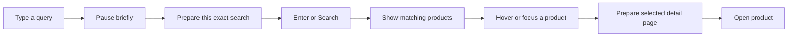

# Responsive Navigation and Search Plan

Prepare likely next pages while the user is reading, hovering or typing, so
ordinary browsing spends less time waiting after a click. Apply this to the
buyer, seller, courier web, logistics and admin portals where it is appropriate.
Keep each portal's existing layout, typography, navigation and feedback.

This is a proposed implementation plan. Writing or accepting these documents
does not implement prefetching, fix pagination, authorize every delivery, or
establish an Azure speed improvement. Current findings and later acceptance
evidence belong in [the roadmap](../CORE_FLOW_ROADMAP.md#october-16-2026-responsive-navigation-and-search-planning).

For the selected PF01 delivery, see [its implementation evidence](../CORE_FLOW_ROADMAP.md#october-16-2026-pf01-buyer-pagination-and-responsive-search)
and [the deployment/manual acceptance guide](ACCEPTANCE.md). Later role batches
retain their own selection and acceptance boundaries.

## Delivery order

| Batch | Outcome | Suggested branch | Dependency |
|---|---|---|---|
| PF01 | [Reliable product pagination, responsive search and initial prefetching](01-buyer-pagination-and-search.md) | `fix/buyer-pagination-and-search-performance` | Existing discovery/eligibility rules; establish the shared policy first |
| PF02 | [Buyer and seller page navigation](02-buyer-and-seller-navigation.md) | `perf/buyer-seller-navigation` | Accepted PF01 cache, request and session boundaries |
| PF03 | [Rider web and logistics navigation](03-rider-and-logistics-navigation.md) | `perf/rider-logistics-navigation` | Accepted shared policy; separate role checks and commits |
| PF04 | [Admin lists and reference navigation](04-admin-navigation.md) | `perf/admin-navigation` | Accepted shared policy; keep review/financial decisions fresh |
| PF05 | [Measured performance and combined acceptance](05-performance-and-release.md) | `perf/navigation-release-checks` | Selected role batches accepted; no silently skipped role gate |

There are five proposed deliveries, not five branches created by this document.
Select PF01 first. Its correctness repair must pass before enabling speculative
loading. Later batches remain separate selections. PF02-PF04 share a prerequisite
rather than a permission to work concurrently. A combined branch requires an
explicit selection and retains each role's acceptance gate.

## Applicable surfaces

| User/surface | Suitable initial candidates | Keep current on actual opening/action |
|---|---|---|
| Guest and buyer | Product cards, category/search results, adjacent results pages; later saved-product browsing | Bag quantities, checkout quotes, stock/price validation, receipt confirmation, private pickup codes |
| Seller | Owned product lists and catalogue previews; read-only navigation where permission remains valid | Inventory edits, fulfillment decisions, reviewed shop corrections and settlement/payment records |
| Courier web | Eligible read-only trip history and ordinary section navigation | Duty, available-job queues, claims, assignment, pickup/delivery scans, COD and handovers |
| Logistics company admin and hub handler | Authorized reference/history lists with the current company/hub scope | Active facility selection, parcel inspection, receiving, sorting, manifests, counter codes, dispatch and cash |
| Platform Admin | Allowed reference/audit lists and non-operational navigation | Approval/rejection forms, current restrictions, identity evidence, custody overrides and financial decisions |

Being a GET route is insufficient to permit prefetching. The shared
[policy](POLICY.md) requires an explicit read-side review, including middleware
and shared props. Reading a conversation can acknowledge messages; inspecting a
notification or advertisement link can also have activity consequences. Keep
such requests tied to real display or intentional activation.

## Search experience

On a general page, the header prepares the current search after a short typing
pause without unexpectedly navigating away. Enter or Search opens that same
query. On the actual results page, a settled query may update the results in
place while preserving focus. Product hover/focus prepares the selected detail
page, and bounded idle work may prepare one next results page.

The first batch defines typing limits, query identity, cancellation, keyboard
and touch behavior, paging, and recovery. Prefetching does not reserve stock or
make an old quote authoritative. It prepares page data; image decoding, page
scripts, database work and rendering may still contribute to waiting.

## Boundaries and scheduling

- Reuse the installed Inertia 2, React and Laravel stack. No framework upgrade,
  new search provider, Redis, service worker, paid service or new deployment
  process is required by this plan.
- Keep all implementation in the Bagoo web repository. The Flutter app and
  native bearer API clients require their own explicitly selected work.
- Preserve business authorization, the original sign-in identity, one-shop
  policy, approved catalogue scope, canonical custody flow and financial rules.
- Use small logical commits. For PF01, separate the pagination repair, shared
  prefetch boundaries, and search behavior where each is independently
  reviewable; attach meaningful verification to the relevant concern.
- Assign real work windows when a batch is selected. Keep them within the
  existing November 20, 2026 target, with review and fix allowance. This plan
  does not create historical work records or promise completion dates for
  unselected branches.

Read [the source and research references](REFERENCES.md), the
[architecture](../ARCHITECTURE.md), [form review](../FORM_VALIDATION_REVIEW.md)
and the relevant role contract before implementation.
